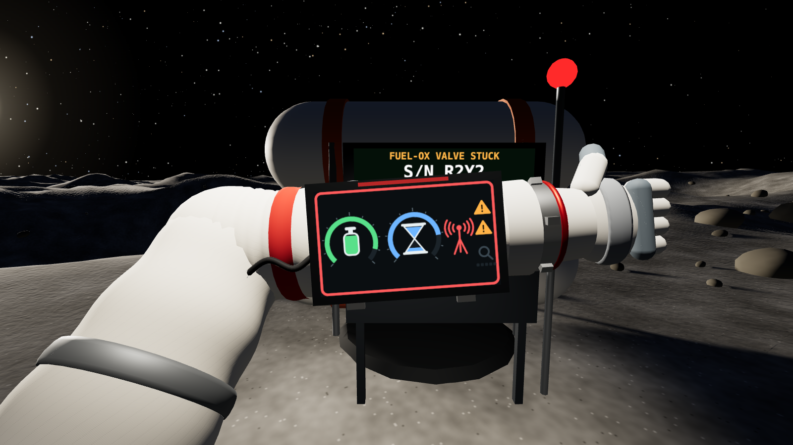
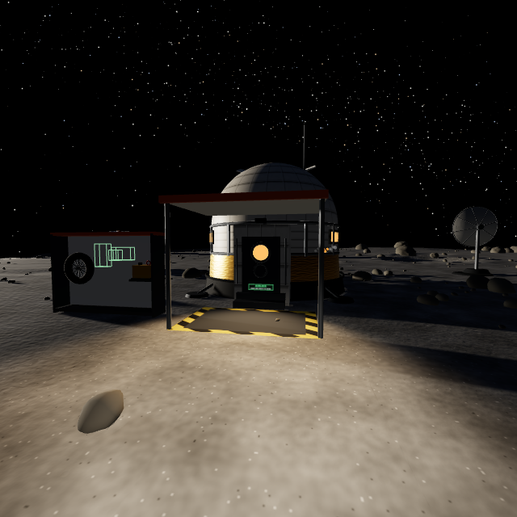

# Moonbase

A co-op fix-it game. One astronaut is on the Moon in VR. Mission control is on laptops, 1.3 light-seconds away. Things keep breaking, and nobody has the whole picture.

- **Astronaut (Quest, or a laptop for testing):** sees the panels, has the hands. No map, no manual.
- **Mission Ops:** the only voice the astronaut hears, over a delayed, crackly radio. Uploads software patches.
- **Technician:** has the map and the rover. Knows *where*.
- **Scientist:** has telemetry and the manual. Knows *how*.

Two players? One person opens "Mission Control", which shows all three consoles.

One person per seat: the landing page greys out seats that are taken, and the server turns away a second person who opens a taken seat's URL.

## Run it

```
npm install
npm start
```

Open `http://localhost:3000` and pick a seat. Mission Ops presses **Start mission** (the standard kit is already loaded, which is the judging mode). A round is 2:30.

Each seat has its own URL, so you can hand them out directly:

| Seat | URL |
| --- | --- |
| Astronaut | `/astronaut` |
| Mission Ops | `/ops` |
| Technician | `/tech` |
| Scientist | `/sci` |
| Mission Control (2-player, all three consoles) | `/control` |

`npm test` runs the game-rule checks.

## Put it on the internet (Cloudflare)

Connect the repo once and every push to `main` deploys itself. Cloudflare gives you HTTPS for free, so VR and the microphone work on the Quest with no certificate warnings, and there is nothing to keep warm: the game room wakes in milliseconds when the first player connects.

1. Cloudflare dashboard, **Workers & Pages**, **Create**, **Import a repository**, pick this repo.
2. Leave the build command empty and the deploy command as `npx wrangler deploy`. Deploy.
3. The dashboard shows the URL, like `https://moonbase-manager.<your-account>.workers.dev`. Hand out `<that URL>/astronaut`, `/ops`, `/tech` and `/sci`.

There is no build step because everything the pages need is committed under `client/`, three.js included. Everyone who opens the site is in the same mission, which is what you want for a demo. The free plan covers this; the room is declared as a SQLite-backed Durable Object because that is the kind the free plan allows. `npm run deploy` does the same from a laptop after `npx wrangler login`.

How it is put together: `worker/index.js` serves `client/` as static files and rewrites the seat URLs onto the two HTML pages, `worker/room.js` is a Durable Object that holds the one game, and both it and the laptop server drive the same `server/hub.js`, so the rules and the 1.3 s delay cannot drift apart. `npm run dev:cf` runs the whole thing locally on `http://localhost:8787`, and `SMOKE_URL=http://localhost:8787 npm run smoke` tests it.

The Quest-over-USB path still needs the laptop server (`npm start`), because that one answers on `localhost`.

## Getting the Quest connected

VR and the microphone only work on `localhost` or over HTTPS. Pick one:

1. **USB cable (simplest).** Run the server on the Mission Ops laptop, plug the Quest in, and run `adb reverse tcp:3000 tcp:3000`. In the Quest browser open `http://localhost:3000/astronaut`. Technician and Scientist laptops can use the plain `http://<ops-laptop-ip>:3000` address, because they need neither VR nor a mic.
2. **HTTPS on the Wi-Fi.** Run `npm run cert` once (needs `openssl`), restart, and open `https://<ip>:3000` on every device. Accept the certificate warning once per device.
3. **Deployed.** Put it on Cloudflare (see "Put it on the internet" above) and open the public `/astronaut` URL in the headset. No cables, no certificate warnings.

If the venue Wi-Fi blocks devices from seeing each other, use a phone hotspot.

## Controls

| | Controllers | Bare hands (hand tracking) | Laptop (testing) |
| --- | --- | --- | --- |
| Radio to Mission Ops, and wrist gauges | hold left trigger | hold your left hand up to your helmet | hold Tab |
| Use a panel | point right hand, pull trigger (within 3 m) | point right hand, pinch and let go | click |
| Move | left stick | point right hand at the ground, pinch and let go to teleport (up to 8 m) | WASD |
| Turn | right stick | pinch left hand, drag it sideways (30° per 10 cm) | mouse |
| Hop | A | | Space |
| Zoom the visor | | pinch both hands, pull them apart (up to 6x); push them together to zoom out | |

Hand tracking kicks in when you put the controllers down; the Quest switches by itself. Your hands are drawn as white gloves, and a green ring on the ground shows where a pinch will take you. A bare right hand acts when the pinch lets go, so you can hold the pinch, steer the ring, and release.

Visor zoom is for reading a panel or a serial number from where you stand: a round scope opens in the middle of your view and magnifies what you are looking at by the amount your hands have moved apart (20 cm to 60 cm is 3x). Let go and it stays. Push your pinched hands back together to close it. It is a hand-tracking gesture only; controllers and the laptop have no zoom. While the scope is open the scene is drawn one extra time, into a 1024-pixel texture.

### No display on the visor



The astronaut has no heads-up display. Everything is on a small cuff display strapped to the left forearm of the suit, and the arm is out of sight until the radio is keyed. Keying the radio and raising the arm are one action: hold the radio control (left trigger, left hand to helmet, or Tab on a laptop) and the arm swings up in front of you; let go and it drops. So you read your oxygen while you are talking.

The display has no words or numbers on it, only icons:

| Icon | Means |
| --- | --- |
| Gas bottle in a dial | suit oxygen: the bottle and the dial empty together, and turn red when low |
| Hourglass in a dial | time left: the sand and the dial run down, amber for the last 30 seconds |
| Tick or cross in place of the hourglass | an alarm just fixed or a mistake just made, for a few seconds; at the end, mission complete or failed |
| Radio mast | red waves while you are transmitting, blue while Mission Ops is talking, an amber bar through it if the page has no microphone |
| Warning triangles | one lit for each active alarm |
| Magnifying glass | lit while the visor zoom is on, with pips for how far in |

The arm being up is itself the sign that your radio is keyed, and the display backs it up: a light strip in its top edge and the frame round the face take the radio's colour. The arm is modelled on an EVA suit's: a woven white outer garment with soft wrinkles, a ribbed elbow, a red identification stripe, the metal wrist disconnect, and a glove with a gauntlet, palm strap, knuckle pad and silicone fingertips. The older screenshots in `docs/` were taken before any of this and still show a strip of text along the bottom of the view; that strip is gone.

Mission Ops holds **Space** to talk. The Technician drives the rover with the **arrow keys**.

## The four alarms

| Alarm | Astronaut sees | Mission control has |
| --- | --- | --- |
| Fuel-ox valve stuck | wire colours and a serial number | Scientist: tank pressure and the rule for which wire to pull |
| Comms dish off frequency | a wave, and +/- buttons, no number | Technician: current channel. Scientist: target channel |
| Airlock software fault | a 4-character fault code, a keypad | Mission Ops: types the code, gets a 3-digit key back |
| Drill jammed | five rocks | Scientist: which colour is the core sample that must stay |

A wrong action costs 8 oxygen. An alarm that times out costs 15. Oxygen at zero ends the mission.

## Where things are

```
client/shared/config.js  every number: round length, delay, penalties, station positions, gear
client/shared/rules.js   puzzle rules and the Scientist's manual text
client/vendor/three/     the three files of three.js the pages import (refresh with npm run vendor)
server/game.js      all game logic and what each role may see (no networking, unit-tested)
server/hub.js       who is connected, what each role may send, the 1.3 s delay, radio relay
server/server.js    the laptop web server and WebSocket, drives hub.js
worker/             the same thing on Cloudflare: a Worker for the pages, a Durable Object for the room
client/astronaut.*  VR client: movement, pointing, visor zoom
client/arm.js       the astronaut's left arm and its wrist gauge cluster
client/stations.js  the four panels the astronaut works at
client/world.js     the Moon scene: terrain, sky, Earth, habitat, rover, lander (shared with the rover camera)
client/console.*    Mission Ops, Technician, Scientist and all-in-one
client/voice.js     push-to-talk radio with 1960s distortion and Quindar beeps
```

Suggested split: A takes `astronaut.js`, `world.js` and the art. B takes `server/`, `worker/` and new minigames. C takes `console.*`. D takes `rules.js`, the manual, audio, pitch and video.

**Adding a minigame** takes three edits: data and checks in `server/game.js` (`makeData`, `act`, `view`), a panel in `client/stations.js`, and a rule in `client/shared/rules.js`. Not built yet from the list: solar array circuits, docking ring maze.

## What has and has not been tested



Everything is procedural, nothing is downloaded: cratered regolith with a generated grain texture and vertex-colour variation, boulder fields from noise-displaced rocks (none inside the play area, so you never walk through one), a Milky Way of 5,000 stars with their own sizes and colours, the sun as a disc and glow along the light direction, and an Earth with continents, drifting clouds, a sunlit atmosphere rim and a phase from the same sun that lights the ground. Filmic tone mapping and an environment map make the gold foil, visors and steel reflect something. The habitat has a ribbed dome, insulated skirt, hatch with porthole, floodlight, radiators and a dish aimed at Earth; the stations, rover and a lander with its flag on the horizon follow suit. The scene is about 250k triangles and 270 draw calls, which is within a Quest 2's budget. The look was tuned from desktop screenshots in `docs/`.

Tested in headless Chromium against the real three.js r180 build: lobby and loadout, a full round with every alarm type solved through the astronaut's panels, the delayed voice link in both directions, rover driving, results, "Fly again", seat locking, and the 3D scene itself: it loads with no errors, everything renders, and using a wire on the fuel depot panel reaches the server through the raycaster, on both the laptop server and the Cloudflare worker. `npm run smoke` repeats the scene check (it needs `npm i -D playwright && npx playwright install chromium` once). `npm run smoke:shots` does the same and leaves screenshots in `test/shots/`; they are off by default because reading a picture back out of a 3D canvas is the one thing software rendering cannot do cheaply, and each one costs the test browser tens of seconds and gigabytes of memory.

The smoke test also drives the hand-tracking gestures without a headset, by firing the same events a pinch fires: both hands pinched and pulled apart zooms (in either pinch order, without teleporting or turning), pushed together zooms out, and the one-handed turn and teleport still work. It then checks that the visor scope's extra pass draws the scene without a WebGL error, that nothing is fixed to the view while the radio is idle, and that the radio key and the arm are one control. With no microphone, holding Tab still brings the arm up with a drawn gauge face showing the no-microphone state in amber and no text at all, the old T key does nothing, and letting go lowers the arm. Then, in a second browser with a pretend microphone, holding Tab brings the arm up, puts the astronaut on the air with a red frame, and shows "ASTRONAUT IS TRANSMITTING" on the Mission Ops seat; letting go ends the transmission; and Mission Ops holding Space reaches the astronaut without raising the arm. It prints each step with a time as it goes.

**Not yet seen on a headset:** the VR controls, hand tracking, the visor zoom drawn inside a live headset session, where the arm and its gauges sit in front of the face, and how the scene performs on the Quest's GPU. Start there, with the Quest plugged in over USB or on the deployed URL. If it stutters, the first things to turn down are in `client/world.js`: the terrain segment count (`SEG`), the boulder counts in the three `scatter` calls, and the shadow map size.

## Science notes for the pitch

- 1.3 s each way is the real Earth-Moon light delay. Voice, rover commands and telemetry all carry it.
- 1.62 m/s² gravity: hops and thrown rocks fall at lunar speed.
- Low sun and long shadows match the lunar south pole, where NASA's Moon Base is planned.
- Rover top speed is about 6 mph, the class of NASA's crewed lunar terrain vehicles.
- Suit oxygen drains about 100 times faster than on a real EVA so a mission fits in 2:30.
- The radio beeps are the Quindar tones used on Apollo.

Independent student project. Not a NASA product and not endorsed by NASA.
