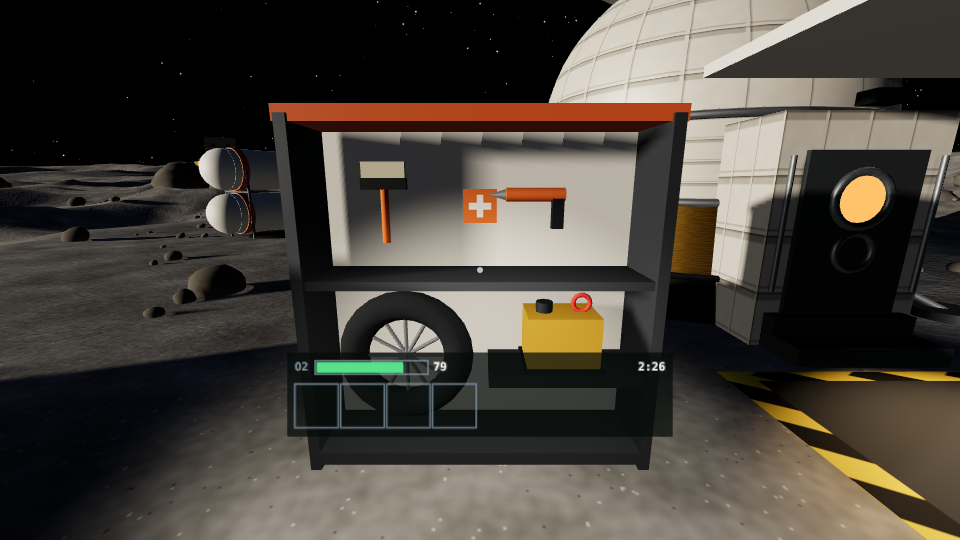
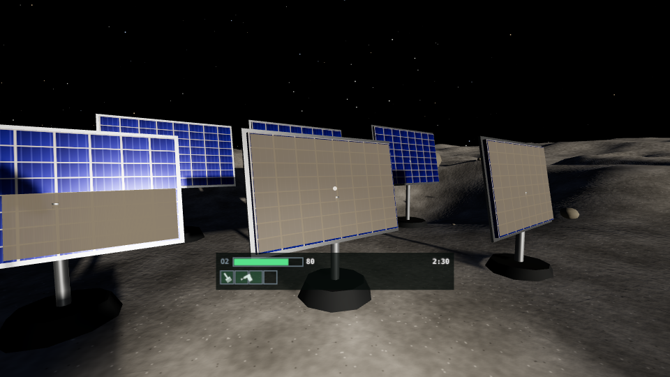
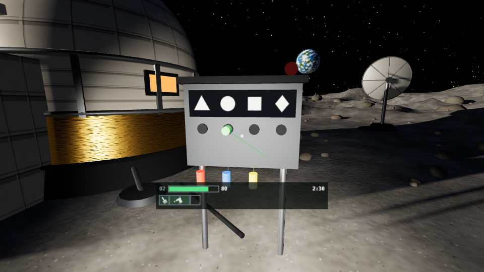
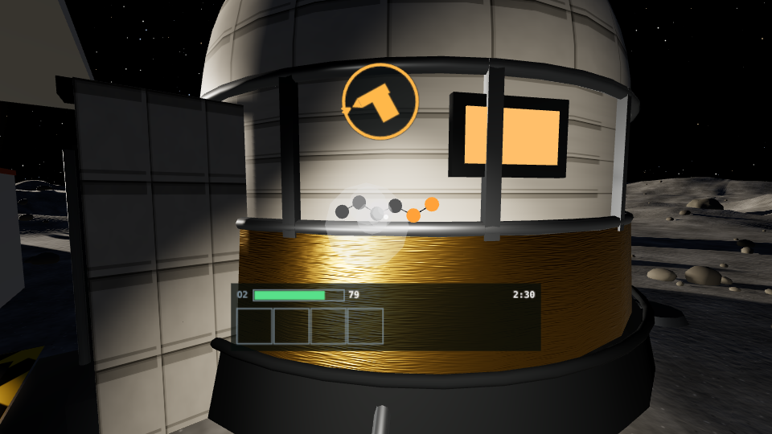
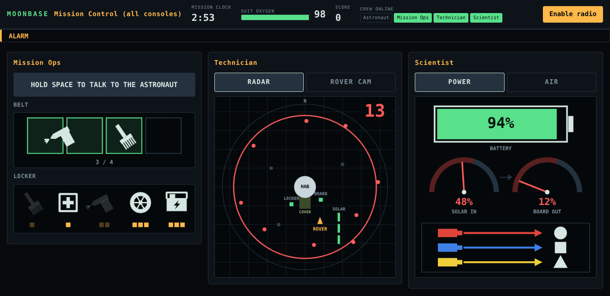

# Moonbase

A co-op fix-it game. One astronaut is on the Moon in VR. Mission control is on laptops, 1.3 light-seconds away. Something breaks. Mission control can see the symptoms but not the cause, the astronaut has the hands but not the information, and fixing things in the wrong order makes everything worse.

- **Astronaut (Quest, or a laptop for testing):** has the hands, a tool belt that holds 4 weight units, and ears. No map, no gauges, no instructions.
- **Mission Ops:** the only voice the astronaut hears, over a delayed, crackly radio. Sees what is on the belt and what is left in the locker.
- **Technician:** the radar map and the rover camera. Knows *where* and *when*.
- **Scientist:** two screens of gauges, POWER and AIR. Knows *what* is wrong.

Mission control reads pictures, not paragraphs: gauges, a map, a camera, a wiring diagram, lamps. Nobody is told in words what broke. The design is in [docs/SPEC-v2.md](docs/SPEC-v2.md).

Two players? One person opens "Mission Control", which shows all three consoles.

The lobby is four scenes side by side: the astronaut on the Moon, the flight director at his console, the Scientist at a lamp-lit desk, and the Technician welding on the VIPER rover. A scene is grey while its seat is open and comes to life, in colour, with its own motion and its own background sound, when someone takes the seat. One person per seat: the server turns away a second person who opens a taken seat's URL.

## Run it

```
npm install
npm start
```

Open `http://localhost:3000` and click a scene to take that seat. Everyone presses **Ready**; the astronaut readies up inside the headset, on the READY board in front of them. When all four roles are held and ready, a 3-second countdown starts the mission. Mission Ops can switch between the **Demo mission** (the same five things break in the same order, for judges) and **Free play** (random faults and meteor showers) from the briefing button in their panel. A round is 3:00.

Testing alone? `SOLO=1 npm start` lets any crew that is all ready start the mission, without the other seats.

Each seat has its own URL, so you can hand them out directly:

| Seat | URL |
| --- | --- |
| Astronaut | `/astronaut` |
| Mission Ops | `/ops` |
| Technician | `/tech` |
| Scientist | `/sci` |
| Mission Control (2-player, all three consoles) | `/control` |

`npm test` runs the game-rule checks.

## Put it on the internet (Cloudflare)

Connect the repo once and every push to `main` deploys itself. Cloudflare gives you HTTPS for free, so VR and the microphone work on the Quest with no certificate warnings, and there is nothing to keep warm: the game room wakes in milliseconds when the first player connects.

1. Cloudflare dashboard, **Workers & Pages**, **Create**, **Import a repository**, pick this repo.
2. Leave the build command empty and the deploy command as `npx wrangler deploy`. Deploy.
3. The dashboard shows the URL, like `https://moonbase-manager.<your-account>.workers.dev`. Hand out `<that URL>/astronaut`, `/ops`, `/tech` and `/sci`.

There is no build step because everything the pages need is committed under `client/`, three.js included. Everyone who opens the site is in the same mission, which is what you want for a demo. The free plan covers this; the room is declared as a SQLite-backed Durable Object because that is the kind the free plan allows. `npm run deploy` does the same from a laptop after `npx wrangler login`.

How it is put together: `worker/index.js` serves `client/` as static files and rewrites the seat URLs onto the two HTML pages, `worker/room.js` is a Durable Object that holds the one game, and both it and the laptop server drive the same `server/hub.js`, so the rules and the 1.3 s delay cannot drift apart. `npm run dev:cf` runs the whole thing locally on `http://localhost:8787`, and `SMOKE_URL=http://localhost:8787 npm run smoke` tests it.

The Quest-over-USB path still needs the laptop server (`npm start`), because that one answers on `localhost`.

## Getting the Quest connected

VR and the microphone only work on `localhost` or over HTTPS. Pick one:

1. **USB cable (simplest).** Run the server on the Mission Ops laptop, plug the Quest in, and run `adb reverse tcp:3000 tcp:3000`. In the Quest browser open `http://localhost:3000/astronaut`. Technician and Scientist laptops can use the plain `http://<ops-laptop-ip>:3000` address, because they need neither VR nor a mic.
2. **HTTPS on the Wi-Fi.** Run `npm run cert` once (needs `openssl`), restart, and open `https://<ip>:3000` on every device. Accept the certificate warning once per device.
3. **Deployed.** Put it on Cloudflare (see "Put it on the internet" above) and open the public `/astronaut` URL in the headset. No cables, no certificate warnings.

If the venue Wi-Fi blocks devices from seeing each other, use a phone hotspot.

## Controls

| | Controllers | Bare hands (hand tracking) | Laptop (testing) |
| --- | --- | --- | --- |
| Talk to Mission Ops | hold left trigger | hold your left hand up to your helmet | hold T |
| Grab (tools off the rack and your belt, cable plugs, the rover wheel, the generator cord) | grip button | pinch | click it |
| Use a tool | bring it to the work: the brush and patch kit work on contact, the welder lights when its tip is on the crack | same | click the work, hold to keep brushing or welding |
| Point at something within arm's reach (a fallback for grabbing) | right trigger | | |
| Take cover | crouch | crouch | hold C |
| Patch your suit / pull the generator cord | patch kit to the red spot on your forearm / grab the generator on your belt and pull | same | F / G |
| Move | left stick | point right hand at the ground, pinch to teleport (up to 8 m) | WASD |
| Turn | right stick | pinch left hand in empty air, drag it sideways (30° per 10 cm) | mouse |
| Hop | A | | Space |

Hand tracking kicks in when you put the controllers down; the Quest switches by itself. Your hands are drawn as white gloves, and a green ring on the ground shows where a pinch will take you.

Mission Ops holds **Space** to talk. The Technician drives the rover with the **arrow keys**.

## Tools and the belt

Tools hang in the locker beside the airlock. The belt carries 4 weight units, and refuses anything that would go over with a red flash and a buzz.

| Tool | Weight | Fixes |
| --- | --- | --- |
| Brush | 1 | Dusty solar panels |
| Patch kit | 1 | Suit leak |
| Welder | 2 | Hull breach |
| Space tire | 3 | Broken rover wheel. Used up when fitted; a new one reaches the locker 30 s later |
| Backup generator | 3 | Nothing. One pull gives 25 s of power during a blackout, once per mission |

Welder, brush and patch kit fill the belt exactly, so the tire or the generator always means leaving something behind. Grab a tool on the rack and it goes on your belt. Let go of a tool at the locker and it goes back; let go anywhere else and it snaps back to your belt, so nothing is ever lost on the ground.

## What breaks

| Fault | What mission control sees | What the astronaut does |
| --- | --- | --- |
| Dusty solar panels | Scientist: battery falling, **SOLAR IN** low | Sweep the brush over all three panels |
| Tripped switchboard | Scientist: battery falling, SOLAR IN fine, **BOARD OUT** low, and a wiring diagram | Push each loose cable into the socket with the right shape. No tool. A wrong socket sparks and costs 4 oxygen |
| Broken rover wheel | Technician: the radar map turns to static | Pull the broken wheel off, push the space tire on |
| Hull breach | Scientist: the **LEAK** lamp, and oxygen draining 3x | Find the hiss, which comes from a place on the habitat wall, and weld along the crack |
| Suit leak | Scientist: the same LEAK lamp, the same 3x drain | The hiss is inside the helmet and does not move when you turn. Patch the red spot on your forearm |
| Meteor shower | Technician: blips and a countdown on the radar, 15 s ahead, if the radar is working | Stand under the airlock canopy, or crouch beside the rover |

And how it cascades, which is where the strategy is:

| Left broken | Then |
| --- | --- |
| A power fault | The battery empties in 45 s and the base blacks out |
| Blackout | The radio is dead both ways and every console shows static, until the power fault is fixed |
| Rover wheel | No radar: no map, no astronaut position, no meteor warning |
| No meteor warning | The astronaut is caught in the open: 20 oxygen gone and a suit leak |
| Any leak | Oxygen drains three times faster. Hull and suit together: five times |

Oxygen at zero is the only way to lose. Surviving to the end of the clock is the only way to win. The astronaut can fix every fault alone, by looking and by trial and error, so a blackout is never a dead end.

## Where things are

```
client/shared/config.js  every number: round length, delay, penalties, tool weights, where things are, the mission scripts
client/shared/rules.js   belt weight and what counts as cover
client/shared/icons.js   the tool and socket-shape pictures, shared by the consoles and the astronaut
client/vendor/three/     the three files of three.js the pages import (refresh with npm run vendor)
server/game.js      all game logic and what each role may see (no networking, unit-tested)
server/hub.js       who is connected, what each role may send, the 1.3 s delay, radio relay
server/server.js    the laptop web server and WebSocket, drives hub.js
worker/             the same thing on Cloudflare: a Worker for the pages, a Durable Object for the room
client/astronaut.*  VR client: movement, grabbing, pointing, crouch, HUD
client/stations.js  the tools, the belt and every repair, each with a grab-it version and a point-at-it version
client/world.js     the Moon scene and everything that can be seen broken (shared with the rover camera)
client/console.*    Mission Ops, Technician, Scientist and all-in-one
client/voice.js     push-to-talk radio with 1960s distortion and Quindar beeps, the leak hiss, and the sound effects
```

**Adding a fault** takes four edits: its name and tool in `FAULTS` (`config.js`); its data, its repair and what each role sees in `server/game.js` (`break`, `act`, `scene`, `view`); how it looks in `world.js` (`apply`); and how hands fix it in `client/stations.js`. To change what happens in the demo, edit `SCRIPTS.demo` in `config.js`.

## What has and has not been tested


| | |
| --- | --- |
|  |  |
|  |  |



Everything is procedural, nothing is downloaded: cratered regolith with a generated grain texture and vertex-colour variation, boulder fields from noise-displaced rocks (none inside the play area, so you never walk through one), a Milky Way of 5,000 stars with their own sizes and colours, the sun as a disc and glow along the light direction, and an Earth with continents, drifting clouds, a sunlit atmosphere rim and a phase from the same sun that lights the ground. Filmic tone mapping and an environment map make the gold foil, visors and steel reflect something. The habitat has a ribbed dome, insulated skirt, hatch with porthole, floodlight, radiators and a dish aimed at Earth; the solar array, switchboard, tool locker, rover and a lander with its flag on the horizon follow suit. The scene is about 260k triangles, which is within a Quest 2's budget. It has five lights and nothing in the repairs adds one, because every light costs the headset on every pixel. The look was tuned from desktop screenshots in `docs/`.

Tested two ways. `npm test` checks the rules in plain Node: the belt's weight limit, every repair refused without its tool or from too far away, the battery draining to a blackout and recovering, voice dropped in both directions during a blackout, the radar and the meteor warning lost with the rover wheel, cover, the meteor hit and the leak it starts, the generator, exactly what each seat is sent, the lobby, and the demo mission played well (a win) and not at all (a loss). `npm run smoke` opens Mission Control and the astronaut in headless Chromium against the real three.js r180 build, readies up, and plays the whole demo mission to a clean win the way a laptop player would: stand somewhere, look at the thing, click. Every repair goes through the same raycast as a mouse click, and the socket for each cable is read off the Scientist's wiring diagram on the other page. It needs `npm i -D playwright && npx playwright install chromium` once and leaves screenshots in `test/shots/`. It passes against the laptop server and against the Cloudflare worker (`npm run dev:cf`, then `SMOKE_URL=http://localhost:8787 npm run smoke`).

**Not yet seen on a headset:** everything you do with your hands. Grabbing tools off the rack and the belt, sweeping the brush, holding the welder on the crack, pushing plugs into sockets, pulling the wheel, the generator cord, patching your forearm, the hiss in your ears, crouching for cover, where the belt and the HUD sit, and how the scene performs on the Quest's GPU. None of that can be run without a headset, so it has only been read, not played. The distances and sizes to tune first are at the top of `client/stations.js` (`GRAB`, `BELT_R`, `BELT_SLOT`, `WELD_RANGE`, `WELD_DWELL`). If a gesture misbehaves on the day, pointing the right trigger at the thing from within 1.6 m does the same job. Start there, with the Quest plugged in over USB or on the deployed URL. If it stutters, the first things to turn down are in `client/world.js`: the terrain segment count (`SEG`), the boulder counts in the three `scatter` calls, and the shadow map size.

## Science notes for the pitch

- 1.3 s each way is the real Earth-Moon light delay. Voice, rover commands and telemetry all carry it.
- 1.62 m/s² gravity: hops and thrown rocks fall at lunar speed.
- Low sun and long shadows match the lunar south pole, where NASA's Moon Base is planned.
- Rover top speed is about 6 mph, the class of NASA's crewed lunar terrain vehicles.
- Suit oxygen drains about 100 times faster than on a real EVA so a mission fits in 2:30.
- The radio beeps are the Quindar tones used on Apollo.

Independent student project. Not a NASA product and not endorsed by NASA.
