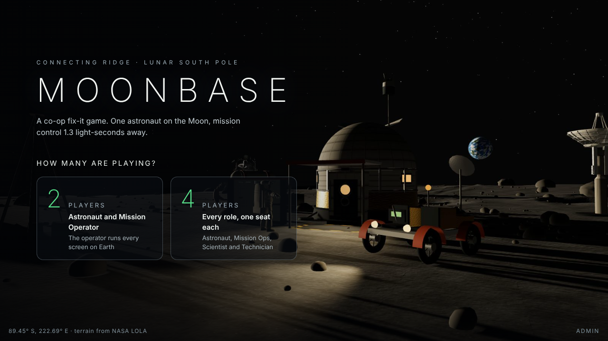
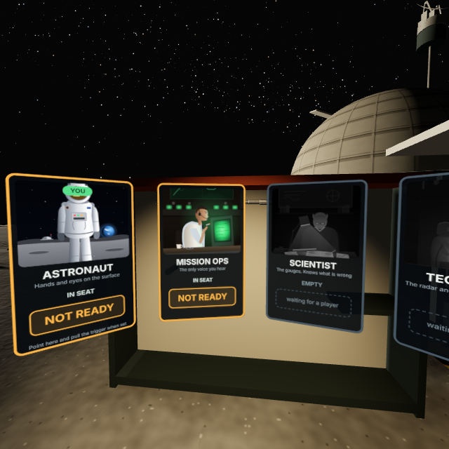
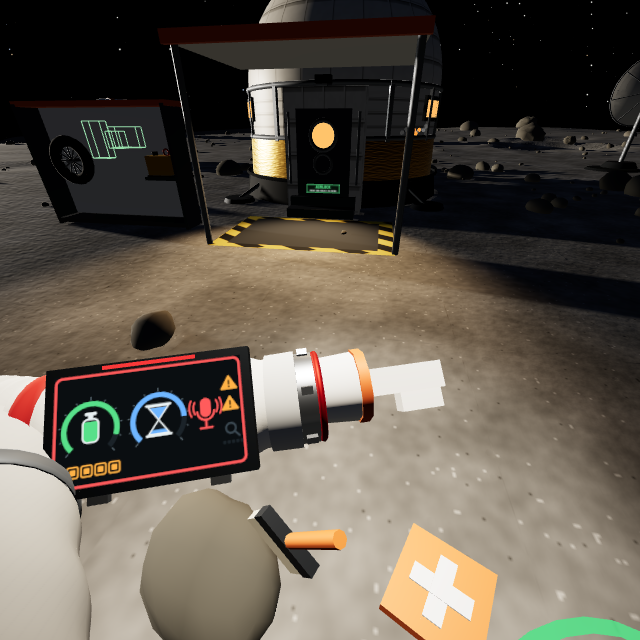
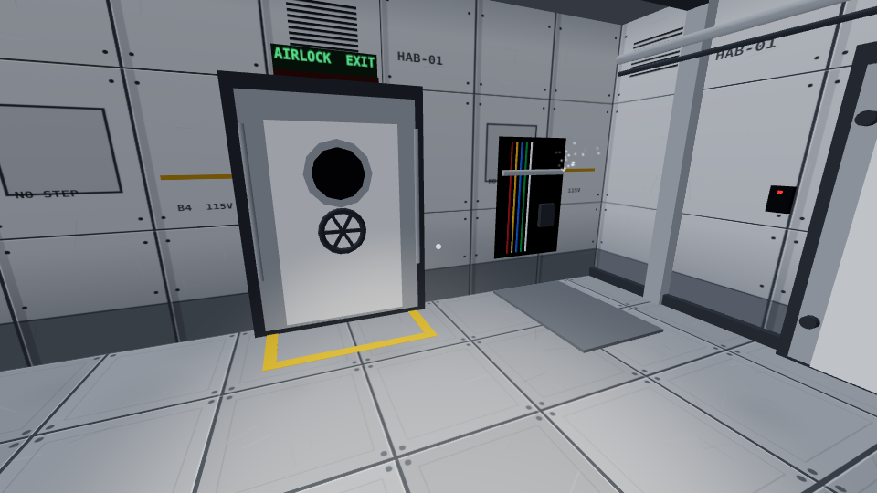
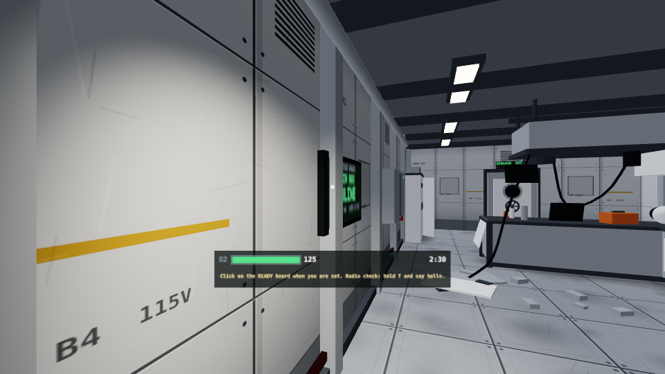
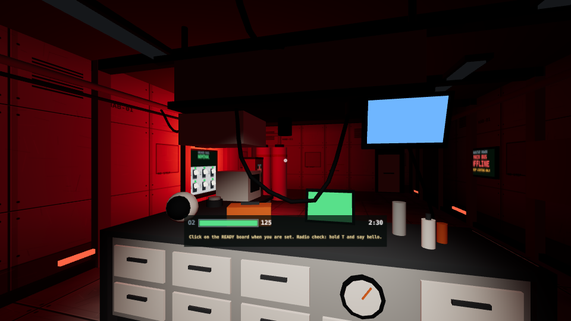
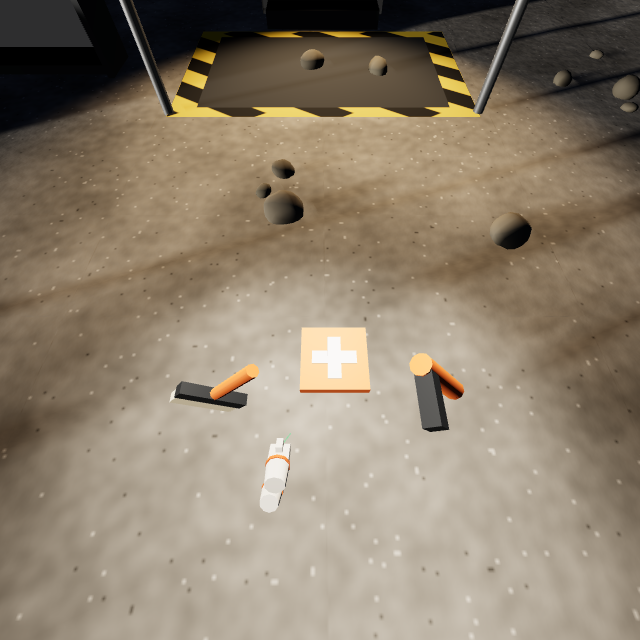
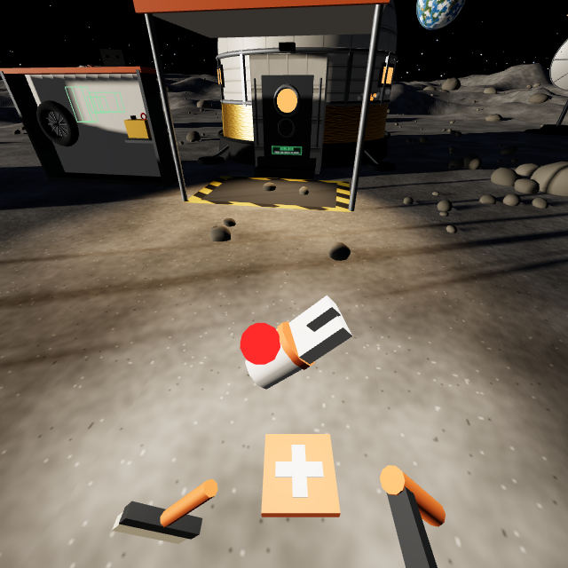

# Moonbase

A co-op fix-it game. One astronaut is on the Moon in VR. Mission control is on laptops, 1.3 light-seconds away. Something breaks. Mission control can see the symptoms but not the cause, the astronaut has the hands but not the information, and fixing things in the wrong order makes everything worse.

- **Astronaut (Quest, or a laptop for testing):** has the hands, a tool belt that holds 4 weight units, and ears. No map, no instructions, and nothing on the visor: oxygen, the clock and the belt are icons on a wrist cuff that comes up while the radio is keyed.
- **Mission Ops:** the only voice the astronaut hears, over a delayed, crackly radio. Sees what is on the belt and what is left in the locker.
- **Technician:** the radar map and the rover camera. Knows *where* and *when*.
- **Scientist:** two screens of gauges, POWER and AIR. Knows *what* is wrong.

Mission control reads pictures, not paragraphs: gauges, a map, a camera, a wiring diagram, lamps. Nobody is told in words what broke. The design is in [docs/SPEC-v2.md](docs/SPEC-v2.md).



**The landing page** shows the base itself, drawn live from the game's own scene: the habitat, the rover, the comms dish, the Apollo lander and the Viking lander on the skyline, Earth low over the real south-pole horizon, the camera drifting slowly past. Over it is one question: **2 players** or **4 players**. The first visitor to answer sets the game for everyone; later visitors are told which game is being set up and join it.

- **2 players:** the Astronaut and one **Mission Operator**, who has every Earth-side screen (Mission Ops, Scientist and Technician on one page). Nobody else can take those seats.
- **4 players:** the Astronaut, Mission Ops, the Scientist and the Technician, one person each, each seeing only their own screen.

**A headset is always the Astronaut.** The landing page knows a headset browser (Quest, Pico and similar), says so, and goes straight to the Astronaut's page as soon as a game is chosen, by anyone; it never offers another role. There, after **Turn on radio** and **Enter VR**, you stand in the **waiting room** on the real site: a card for each seat in the game stands in an arc in front of you, two or four, showing the role, whether someone is in it and whether they are ready. Turn your head to look along them. Point at your own card (it says YOU) and pull the trigger, or pinch, to ready up. Taking the headset off makes you not ready. If someone else already holds the Astronaut seat, the headset waits for it rather than being sent elsewhere. A desktop PC with a tethered headset counts as a laptop, and Apple Vision Pro is not recognised; add `?device=headset` (or `?device=laptop`) to any address to say which it is.




Once the game is chosen, a laptop picks its seat in the lobby: four scenes side by side in a 4-player game (two in a 2-player game, the Mission Operator drawn in the flight director's): the astronaut on the Moon, the flight director at his console, the Scientist at a lamp-lit desk, and the Technician welding on the VIPER rover. A scene is grey while its seat is open and comes to life, in colour, with its own motion and its own background sound, when someone takes the seat. One person per seat: the server turns away a second person who opens a taken seat's URL.

## Run it

```
npm install
npm start
```

Open `http://localhost:3000`, choose **2** or **4 players**, and click a scene to take that seat (a headset skips this and is the Astronaut). Everyone presses **Ready**; the astronaut readies up inside the headset, on their own card in the waiting room. When every seat in the game is held and ready, a 3-second countdown starts the mission. Mission Ops can switch between the **Demo mission** (the same five things break in the same order, for judges) and **Free play** (random faults and meteor showers) from the briefing button in their panel. A round is 3:00.

Testing alone? `SOLO=1 npm start` lets any crew that is all ready start the mission, without the other seats.

Each seat has its own URL, so you can hand them out directly once the game is chosen. A seat the game does not have says so (the Scientist in a 2-player game, say), and any seat opened before a game is chosen goes to the landing page first:

| Seat | URL |
| --- | --- |
| Astronaut | `/astronaut` |
| Mission Ops (4-player games) | `/ops` |
| Technician (4-player games) | `/tech` |
| Scientist (4-player games) | `/sci` |
| Mission Operator (2-player games only: all three consoles) | `/control` |
| Admin (start, reset, kick; not a seat) | `/admin` |

**`/admin` is the referee's console.** It is not a seat and nothing on it is delayed. It can start the mission now (skipping the ready-up, with whoever is in), restart it, **reset** (the game ends and everyone goes back to the landing page to choose 2 or 4 players again; **Fly again** on the results screen does the same), clear the choice of 2 or 4 players, pick the mode, and **kick** any seat: every connection holding that seat is dropped and the seat is free again at once. That is the fix for a seat that reads taken when nobody is actually there (a headset that went to sleep, a tab closed without saying goodbye). The person kicked sees a notice and can rejoin. The console is open by default; to lock it, start the server with `ADMIN_KEY=something npm start` (on Cloudflare, add `ADMIN_KEY` as a Worker variable or secret) and open `/admin?key=something` once per browser.

`npm test` runs the game-rule checks.

## Put it on the internet (Cloudflare)

Connect the repo once and every push to `main` deploys itself. Cloudflare gives you HTTPS for free, so VR and the microphone work on the Quest with no certificate warnings, and there is nothing to keep warm: the game room wakes in milliseconds when the first player connects.

1. Cloudflare dashboard, **Workers & Pages**, **Create**, **Import a repository**, pick this repo.
2. Leave the build command empty and the deploy command as `npx wrangler deploy`. Deploy.
3. The dashboard shows the URL, like `https://moonbase-manager.<your-account>.workers.dev`. Hand out `<that URL>/astronaut`, `/ops`, `/tech` and `/sci`. The live deployment is at **https://moonbasemanagedfrom.earth** (a custom domain on the same Worker): seats are `/astronaut`, `/ops`, `/tech`, `/sci`, `/control` for two players, and `/admin` for the referee.

There is no build step because everything the pages need is committed under `client/`, three.js included. Everyone who opens the site is in the same mission, which is what you want for a demo. The free plan covers this; the room is declared as a SQLite-backed Durable Object because that is the kind the free plan allows. `npm run deploy` does the same from a laptop after `npx wrangler login`.

How it is put together: `worker/index.js` serves `client/` as static files and rewrites the seat URLs onto the two HTML pages, `worker/room.js` is a Durable Object that holds the one game, and both it and the laptop server drive the same `server/hub.js`, so the rules and the 1.3 s delay cannot drift apart. `npm run dev:cf` runs the whole thing locally on `http://localhost:8787`, and `SMOKE_URL=http://localhost:8787 npm run smoke` tests it.

The Quest-over-USB path still needs the laptop server (`npm start`), because that one answers on `localhost`.

## Getting the Quest connected

VR and the microphone only work on `localhost` or over HTTPS. Pick one:

1. **USB cable (simplest).** Run the server on the Mission Ops laptop, plug the Quest in, and run `adb reverse tcp:3000 tcp:3000`. In the Quest browser open `http://localhost:3000/astronaut`. Technician and Scientist laptops can use the plain `http://<ops-laptop-ip>:3000` address, because they need neither VR nor a mic.
2. **HTTPS on the Wi-Fi.** Run `npm run cert` once (needs `openssl`), restart, and open `https://<ip>:3000` on every device. Accept the certificate warning once per device.
3. **Deployed.** Put it on Cloudflare (see "Put it on the internet" above) and open the public `/astronaut` URL in the headset. No cables, no certificate warnings.

If the venue Wi-Fi blocks devices from seeing each other, use a phone hotspot.

## Controls

| | Controllers | Bare hands (hand tracking) | Laptop (testing) |
| --- | --- | --- | --- |
| Radio to Mission Ops, and wrist gauges | raise your left wrist where you can read it, like a watch (the left trigger also keys the radio, without looking) | raise your left wrist where you can read it (a left hand held to the helmet also keys the radio) | hold Tab |
| Grab (tools off the rack and your belt, cable plugs, the rover wheel, the generator cord) | grip button, with your hand on it | pinch, with your fingers on it | click it |
| Use a tool | bring it to the work: the brush and patch kit work on contact, the welder lights when its tip is on the crack | same | click the work, hold to keep brushing or welding |
| Point at something within arm's reach (a fallback for grabbing) | right trigger | | |
| Go in or out of the habitat | point at the airlock hatch, pull trigger | point at the hatch, pinch and let go | click the hatch |
| Take cover | crouch | crouch | hold C |
| Patch your suit / pull the generator cord | patch kit to the red spot on your forearm / grab the generator on your belt and pull | same | F / G |
| Move | left stick | point right hand at the ground, pinch to teleport (up to 8 m) | WASD |
| Turn | right stick | pinch left hand in empty air, drag it sideways (30° per 10 cm) | mouse |
| Zoom the visor | | pinch both empty hands, pull them apart (up to 6x); push them together to zoom out | |
| Hop | A | | Space |

Hand tracking kicks in when you put the controllers down; the Quest switches by itself. Your hands are drawn as white gloves, and a green ring on the ground shows where a pinch will take you. A pinch on a tool, a plug or the wheel grabs it at once; a bare right hand pointing at the hatch, the READY board or the ground acts when the pinch lets go, so you can hold the pinch, steer the ring, and release.

Mission Ops holds **Space** to talk. The Technician drives the rover with the **arrow keys**.

Visor zoom is for looking at something from where you stand, such as whether the solar panels are dusty: a round scope opens in the middle of your view and magnifies what you are looking at by the amount your hands have moved apart (20 cm to 60 cm is 3x). Let go and it stays. Push your pinched hands back together to close it. It is a hand-tracking gesture only; controllers and the laptop have no zoom. While the scope is open the scene is drawn one extra time, into a 1024-pixel texture.

### No display on the visor


The astronaut has no heads-up display. Everything is on a small cuff display strapped to the back of the left forearm of the suit, and reading it is what turns the radio on.

- **In a headset** the cuff is on your own left arm: it follows the left controller or the tracked left hand. Bring it up where you can read it, the way you look at a watch, and the radio is on; lower it, turn it over or look away and the radio is off. "Can read it" means the face of the cuff is turned toward your eyes, within about half a metre, and near the middle of your view, held for a quarter of a second so that an arm swinging past does not key the radio. The left trigger, and a bare left hand held to the helmet, still key the radio without looking.
- **On a laptop** hold Tab: the arm swings up in front of you and the radio is on; let go and it drops.

Either way you read your oxygen while you are talking.



The display has no words or numbers on it, only icons:

| Icon | Means |
| --- | --- |
| Gas bottle in a dial | suit oxygen: the bottle and the dial empty together, and turn red when low |
| Hourglass in a dial | time left: the sand and the dial run down, amber for the last 30 seconds |
| Tick or cross in place of the hourglass | something just fixed, or a wrong plug or a meteor hit, for a few seconds; at the end, mission complete or failed |
| Microphone | the radio. A grey outline while it is off; solid red with sound coming off it while you are on the air; an amber bar through it if the page has no microphone; a red bar through it during a blackout: no signal |
| Loudspeaker, in place of the microphone | blue, while Mission Ops is talking to you |
| Warning triangles | one lit for each thing that is broken right now (up to two). They do not say what |
| Row of four boxes | the tool belt: one box per weight unit, filled for each unit in use, amber when full |
| Magnifying glass | lit while the visor zoom is on, with pips for how far in |

The microphone is the sign that your radio is on, and the display backs it up: a light strip in its top edge and the frame round the face take the radio's colour. The arm is modelled on an EVA suit's: a woven white outer garment with soft wrinkles, a ribbed elbow, a red identification stripe, the metal wrist disconnect, and a glove with a gauntlet, palm strap, knuckle pad and silicone fingertips.

Mission Ops holds **Space** to talk. The Technician drives the rover with the **arrow keys**.


## Tools and the belt

Tools hang in the locker beside the airlock. The belt carries 4 weight units, and refuses anything that would go over with a red flash and a buzz.

| Tool | Weight | Fixes |
| --- | --- | --- |
| Brush | 1 | Dusty solar panels |
| Patch kit | 1 | Suit leak |
| Welder | 2 | Hull breach |
| Space tire | 3 | Broken rover wheel. Used up when fitted; a new one reaches the locker 30 s later |
| Backup generator | 3 | Nothing. One pull gives 25 s of power during a blackout, once per mission |

Welder, brush and patch kit fill the belt exactly, so the tire or the generator always means leaving something behind. Grab a tool on the rack and it is on your belt and in your hand, ready to use. Let go and it hangs on your belt. To put one back, take it off your belt and let go of it at the locker. A tool let go anywhere else snaps back to your belt, so nothing is ever lost on the ground.

Nothing on the rack is below waist height, and the belt rides at your hips: it stays there when you bend over the rover's wheel, and only sinks when you crouch right down.

### What your hands tell you (headset)

| You see or feel | It means |
| --- | --- |
| A green ring, and a light tick in that hand | this is what the hand will grab if you close it now |
| A red ring on a tool on the rack | too heavy for what is already on your belt. Close your hand and it shakes, buzzes twice, and stays |
| A buzz as your hand closes | you have it |
| A tick for each patch of dust, and a puff off the panel | brushed clean |
| A steady buzz, a spark, and the point of the crack glowing redder | welding: stay on that point. A strong buzz and a bright bead: done, move along |
| A white ring on a socket | the plug in your hand will go in there. Red: that socket is full |
| The wheel, or the generator cord, buzzing harder as you pull | keep pulling: 30 cm for the wheel, 40 cm for the cord |
| One arm throbbing, with a red spot on its cuff | that is the suit leak. Press the patch kit on the spot |
| Impacts that sound dull and far off | you are under cover |

Controllers get a suit glove so there is a hand to see. With bare hands the Quest's own tracked joints are drawn, and there is no buzz: the rings, the sounds and what you see carry it.

## What breaks

| Fault | What mission control sees | What the astronaut does |
| --- | --- | --- |
| Dusty solar panels | Scientist: battery falling, **SOLAR IN** low | Sweep the brush over all three panels |
| Tripped switchboard | Scientist: battery falling, SOLAR IN fine, **BOARD OUT** low, and a wiring diagram. The habitat's windows turn red | Go in through the airlock. The board is on the west wall of the hall. Push each loose cable into the socket with the right shape. No tool. A wrong socket sparks and costs 4 oxygen |
| Broken rover wheel | Technician: the radar map turns to static | Pull the broken wheel off, push the space tire on |
| Hull breach | Scientist: the **LEAK** lamp, and oxygen draining 3x | Find the hiss: it comes from a place on the habitat wall, louder in the ear that is nearer and louder as you walk toward it. Weld along the crack, 0.4 s on each of its six points |
| Suit leak | Scientist: the same LEAK lamp, the same 3x drain | The hiss is inside the helmet and does not move when you turn. Patch the red spot on your forearm |
| Meteor shower | Technician: blips and a countdown on the radar, 15 s ahead, if the radar is working | Stand under the airlock canopy, go inside, or crouch beside the rover. Crouching is measured against how tall you stand (below about two thirds), so it works for a child and for someone seated |

And how it cascades, which is where the strategy is:

| Left broken | Then |
| --- | --- |
| A power fault | The battery empties in 60 s and the base blacks out |
| Blackout | The radio is dead both ways and every console shows static, until the power fault is fixed |
| Rover wheel | No radar: no map, no astronaut position, no meteor warning |
| No meteor warning | The astronaut is caught in the open: 20 oxygen gone and a suit leak |
| Any leak | Oxygen drains three times faster. Hull and suit together: five times |

## Inside the habitat

The airlock hatch on the dome is a door. Point at it and select, and after a short fade you are standing in the hall inside: workbench island, suit lockers, a ceiling gantry trailing cables, life support in the far corner, and the switchboard on the west wall. It is 12 m by 7 m, bigger than the dome looks from outside, which nobody can see because only one of the two places is ever drawn.

Eight roof lights keep it lit. When the switchboard trips, or the battery runs flat, they flicker and die, the hall is dark for a second and a half, then a relay clunks and six red backup lights come up. From outside, the floodlight goes out and the windows turn dim red (black in a full blackout), which the Technician can see through the rover camera. Seat the cables and the roof lights re-strike row by row, starting at the board. Being inside counts as cover from a meteor shower, and a hull breach is heard from the airlock end of the hall. On a laptop, **L** runs the lighting sequence without waiting for the alarm.

The hall is kept clean, and faults show up in it. When the switchboard trips, the ceiling panel over it swings down on its hinge and the conduit cable tears out of its clips and hangs sparking to the floor. A hull breach pops the wall panel beside the airlock: it slides down the wall, tips over onto its face and the pipe behind it vents. A meteor shower shakes a ceiling panel loose up the hall and drops a cable off the gantry. Everything falls at lunar gravity, so slowly. Fix the fault and the pieces go back where they were. On a laptop, **K** knocks everything loose at once. The breakables are `client/damage.js`.







The timings are `CFG.power` in `client/shared/config.js`. The room is `client/interior.js`.

Oxygen at zero is the only way to lose. Surviving to the end of the clock is the only way to win. The astronaut can fix every fault alone, by looking and by trial and error, so a blackout is never a dead end.

## Where things are

```
client/shared/config.js  every number: round length, delay, penalties, tool weights, where things are, the mission scripts
client/shared/rules.js   belt weight and what counts as cover
client/shared/icons.js   the tool and socket-shape pictures, shared by the consoles and the astronaut
client/shared/horizon.js real LOLA terrain and 360-degree horizon for the site (generated by scripts/lola-horizon.py)
client/vendor/three/     the three files of three.js the pages import (refresh with npm run vendor)
server/game.js      all game logic and what each role may see (no networking, unit-tested)
server/hub.js       who is connected, what each role may send, the 1.3 s delay, radio relay, admin commands
server/server.js    the laptop web server and WebSocket, drives hub.js
worker/             the same thing on Cloudflare: a Worker for the pages, a Durable Object for the room
client/astronaut.*  VR client: movement, grabbing, pointing, crouch, visor zoom, the airlock
client/arm.js       the astronaut's left arm and its wrist gauge cluster
client/interior.js  the hall inside the habitat: geometry, the lighting states, where you can walk
client/damage.js    what comes loose in the hall when a fault hits, and goes back when it is fixed
client/stations.js  the tools, the belt and every repair, each with a grab-it version and a point-at-it version
client/world.js     the Moon scene and everything that can be seen broken (shared with the rover camera)
client/index.html   the landing page: landing.js (2 or 4 players, then the seat picker), backdrop.js (the base in 3D)
client/device.js    is this browser in a VR headset?
client/waitingroom.js the astronaut's waiting room: a card per seat, and readying up from your own
client/console.*    Mission Ops, Technician, Scientist and all-in-one
client/admin.*      the referee's console: start, reset, kick a seat free
client/voice.js     push-to-talk radio with 1960s distortion and Quindar beeps, the leak hiss, and the sound effects
test/fakexr.js      a pretend VR headset for tests: head, controllers with haptics, tracked hands
test/vr.mjs         every repair done by hand in that headset (npm run vr)
```

**Adding a fault** takes four edits: its name and tool in `FAULTS` (`config.js`); its data, its repair and what each role sees in `server/game.js` (`break`, `act`, `scene`, `view`); how it looks in `world.js` (`apply`); and how hands fix it in `client/stations.js`. To change what happens in the demo, edit `SCRIPTS.demo` in `config.js`.

## What has and has not been tested

The pictures below are the left eye of the pretend headset the tests use (see "What has and has not been tested"), with controllers in the hands.


| | |
| --- | --- |
|  |  |
|  |  |
|  |  |


Nothing is downloaded at run time: real LOLA terrain and skyline (see "Where the Moon comes from"), regolith with a generated grain texture and vertex-colour variation, boulder fields from noise-displaced rocks (none inside the play area, so you never walk through one), a Milky Way of 5,000 stars with their own sizes and colours, the sun as a disc and glow along the light direction, and an Earth with continents, drifting clouds, a sunlit atmosphere rim and a phase from the same sun that lights the ground. Filmic tone mapping and an environment map make the gold foil, visors and steel reflect something. The habitat has a ribbed dome, insulated skirt, hatch with porthole, floodlight, radiators and a dish aimed at Earth; the solar array, switchboard, tool locker, rover and a lander with its flag on the horizon follow suit. The scene is about 260k triangles, which is within a Quest 2's budget. It has five lights and nothing in the repairs adds one, because every light costs the headset on every pixel. The look was tuned from desktop screenshots in `docs/`.

Tested three ways. `npm test` checks the rules in plain Node: the first choice of 2 or 4 players wins, each game refuses the other's seats and starts with its own, a reset or 60 seconds with nobody seated forgets the choice; the belt's weight limit, every repair refused without its tool or from too far away, the battery draining to a blackout and recovering, voice dropped in both directions during a blackout, the radar and the meteor warning lost with the rover wheel, cover, the meteor hit and the leak it starts, the generator, exactly what each seat is sent, the lobby, and the demo mission played well (a win) and not at all (a loss). `npm run smoke` starts on the landing page (the 3D scene draws without a WebGL error, choosing 2 players opens a two-panel seat picker, a second choice does not change the game, and the Scientist's seat is refused in a 2-player game), then opens Mission Control and the astronaut in headless Chromium against the real three.js r180 build, readies up, and plays the whole demo mission to a clean win the way a laptop player would: stand somewhere, look at the thing, click. Every repair goes through the same raycast as a mouse click, the switchboard is reached through the airlock, and the socket for each cable is read off the Scientist's wiring diagram on the other page. It then drives the hand-tracking gestures by firing the events a pinch fires (zoom in either pinch order, turn, teleport on release), checks the visor scope's extra pass, the wrist gauges with no microphone (icons only, nothing else fixed to the view), the hall's outage lighting, and, in a second browser with a pretend microphone, the radio both ways. It needs `npm i -D playwright && npx playwright install chromium` once `npm run smoke:shots` also saves screenshots in `test/shots/`. It passes against the laptop server and against the Cloudflare worker (`npm run dev:cf`, then `SMOKE_URL=http://localhost:8787 npm run smoke`).

`npm run vr` starts on the landing page as a headset (`?device=headset`): it says you will be the Astronaut, and choosing 4 players seats you there with no picker; in the waiting room there are four cards left to right, one changes when someone takes a seat, the trigger on your own card readies you, taking the headset off un-readies you, and the stick does not walk you out. Then it puts the astronaut's page in a pretend headset (`test/fakexr.js`, a stand-in for the browser's WebXR: a head, two controllers with grip, trigger and haptics, or two tracked hands with a pinch) and does every repair by hand, the way a player in a Quest would: reach for the tool, close the hand, bring it to the work. With controllers it takes tools off the rack and the belt with either hand, is refused the tire on a full belt, sweeps the brush over all three panels (and checks that waving it 35 cm off the panel does nothing), welds the crack point by point (and that leaving a point early does not weld it), goes in through the airlock and pushes plugs into a full socket, a wrong one and the right ones, pulls the wheel and fits the tire, pulls the generator cord in a blackout, patches each forearm with the other hand, listens to the hiss in each ear with the crack on the left, on the right, near and far, and stands, crouches and hides through meteor showers. It repeats the grabbing with bare hands and checks that a pinch on a tool grabs while two empty-handed pinches still zoom. With a pretend microphone it then checks the cuff, with controllers and with bare hands: the arm hanging at the side leaves the radio off, an arm brought up for an instant does not key it, holding the cuff up like a watch puts the astronaut on the air with the microphone icon lit, the cuff then faces the eyes the right way up on the forearm behind the wrist, and looking away, turning the arm over or lowering it turns the radio off. It also measures how far every action makes the arm reach, and fails if any needs more than 0.8 m: that check is why the tire and the generator were moved up the rack and why the belt stays at the hips. The last step draws real frames for both eyes. `npm run vr:shots` saves those as pictures in `test/shots/`.

**What that leaves untested: a real headset.** The pretend one proves the code runs and the distances are reachable. It cannot say whether the gestures feel right, whether the belt sits where a hand expects it, whether the haptics are too strong, how real hand tracking behaves when a pinch is half-recognised, or how the scene performs on the Quest's GPU. Try those first on the day. Every distance is a named constant at the top of `client/stations.js` (`GRAB`, `GRAB_RACK`, `SOCKET_SNAP`, `WHEEL_PULL`, `CORD_PULL`, `TIRE_FIT`, `PATCH_RANGE`, `BELT_AT`, `WELD_RANGE`, `WELD_DWELL`). If a gesture misbehaves, pointing the right trigger at the thing from within 1.6 m does the same job. If it stutters, the first things to turn down are in `client/world.js`: the terrain segment count (`SEG`), the boulder counts in the three `scatter` calls, and the shadow map size.

## Where the Moon comes from

The base stands on the **Connecting Ridge** between Shackleton and de Gerlache craters at the lunar south pole, 89.45 S 222.69 E, 1,956 m above the reference sphere: one of NASA's Artemis III candidate landing regions and a classic high-illumination site. Two things in the scene are measured, not invented:

- **The ground and the skyline** come from NASA's Lunar Reconnaissance Orbiter laser altimeter (LOLA). `scripts/lola-horizon.py` reads two LOLA Gridded Data Record polar DEMs from the PDS Geosciences Node (20 m/px within 2.5 degrees of the pole, 80 m/px within 10 degrees), checks its orientation against Shackleton, Malapert, Shoemaker, Haworth, Faustini and Cabeus, cuts a 1.5 km square of real terrain around the site, and ray-marches the 360-degree horizon out to 290 km with the Moon's curvature. The result is `client/shared/horizon.js`. From a ridge top the real horizon sits almost entirely *below* eye level (between -2.9 and +0.2 degrees), which is why the view feels like standing on a hill: you are looking down into Shackleton on one side and de Gerlache on the other. Scene -z is the 0 E meridian, the direction Earth hangs in.
- **The craters** too small for the DEM to show (3 to 100 m) follow the lunar equilibrium crater size-frequency distribution, N(>D) = 10^-1.1 D^-1.83 per km^2 with D in km (Trask 1966; the saturated small-crater population in Neukum, Ivanov and Hartmann 2001). That gives about 150 craters wider than 10 m and 1,300 wider than 3 m in the 1.5 km square, each with a parabolic bowl, a raised rim and an ejecta skirt, mixed fresh and degraded. Centimetre-scale craters with the same slope are stamped into the ground's bump map.

Two deliberate departures from reality, both for play: the sun is 5 degrees up (at the pole it never exceeds about 1.5 degrees, which would put nearly everything in shadow), at an azimuth the script picks where the real horizon is lowest; and Earth is drawn at 1.5 times its true angular size, at the 4.5 degree elevation it reaches at favourable libration.

To regenerate: download `ldem_875s_20m.img/.lbl` and `ldem_80s_80m.img/.lbl` from `https://pds-geosciences.wustl.edu/lro/lro-l-lola-3-rdr-v1/lrolol_1xxx/data/lola_gdr/polar/img/` (115 MB each) into one folder and run `python3 -I scripts/lola-horizon.py <that folder>`. Change `SITE` in the script to move the base anywhere south of 87.5 S.

## Science notes for the pitch

- 1.3 s each way is the real Earth-Moon light delay. Voice, rover commands and telemetry all carry it.
- 1.62 m/s² gravity: hops and thrown rocks fall at lunar speed.
- The ground and skyline are real LOLA topography of the Shackleton-de Gerlache connecting ridge, an Artemis III candidate site; the small craters follow the measured lunar crater size-frequency distribution.
- Rover top speed is about 6 mph, the class of NASA's crewed lunar terrain vehicles.
- Suit oxygen drains about 100 times faster than on a real EVA so a mission fits in 2:30.
- The radio beeps are the Quindar tones used on Apollo.

Independent student project. Not a NASA product and not endorsed by NASA.
