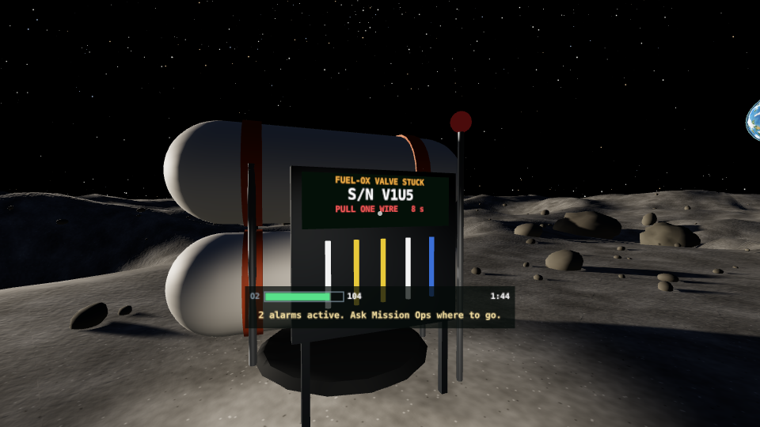

# Moonbase

A co-op fix-it game. One astronaut is on the Moon in VR. Mission control is on laptops, 1.3 light-seconds away. Things keep breaking, and nobody has the whole picture.

- **Astronaut (Quest, or a laptop for testing):** sees the panels, has the hands. No map, no manual.
- **Mission Ops:** the only voice the astronaut hears, over a delayed, crackly radio. Uploads software patches.
- **Technician:** has the map and the rover. Knows *where*.
- **Scientist:** has telemetry and the manual. Knows *how*.

Two players? One person opens "Mission Control", which shows all three consoles.

## Run it

```
npm install
npm start
```

Open `http://localhost:3000` and pick a seat. Mission Ops presses **Start mission** (the standard kit is already loaded, which is the judging mode). A round is 2:30.

Each seat has its own URL, so you can hand them out directly:

| Seat | URL |
| --- | --- |
| Astronaut | `/astronaut` |
| Mission Ops | `/ops` |
| Technician | `/tech` |
| Scientist | `/sci` |
| Mission Control (2-player, all three consoles) | `/control` |

`npm test` runs the game-rule checks.

## Put it on the internet (Cloudflare)

Connect the repo once and every push to `main` deploys itself. Cloudflare gives you HTTPS for free, so VR and the microphone work on the Quest with no certificate warnings, and there is nothing to keep warm: the game room wakes in milliseconds when the first player connects.

1. Cloudflare dashboard, **Workers & Pages**, **Create**, **Import a repository**, pick this repo.
2. Leave the build command empty and the deploy command as `npx wrangler deploy`. Deploy.
3. The dashboard shows the URL, like `https://moonbase-manager.<your-account>.workers.dev`. Hand out `<that URL>/astronaut`, `/ops`, `/tech` and `/sci`.

There is no build step because everything the pages need is committed under `client/`, three.js included. Everyone who opens the site is in the same mission, which is what you want for a demo. The free plan covers this; the room is declared as a SQLite-backed Durable Object because that is the kind the free plan allows. `npm run deploy` does the same from a laptop after `npx wrangler login`.

How it is put together: `worker/index.js` serves `client/` as static files and rewrites the seat URLs onto the two HTML pages, `worker/room.js` is a Durable Object that holds the one game, and both it and the laptop server drive the same `server/hub.js`, so the rules and the 1.3 s delay cannot drift apart. `npm run dev:cf` runs the whole thing locally on `http://localhost:8787`, and `SMOKE_URL=http://localhost:8787 npm run smoke` tests it.

The Quest-over-USB path still needs the laptop server (`npm start`), because that one answers on `localhost`.

## Getting the Quest connected

VR and the microphone only work on `localhost` or over HTTPS. Pick one:

1. **USB cable (simplest).** Run the server on the Mission Ops laptop, plug the Quest in, and run `adb reverse tcp:3000 tcp:3000`. In the Quest browser open `http://localhost:3000/astronaut`. Technician and Scientist laptops can use the plain `http://<ops-laptop-ip>:3000` address, because they need neither VR nor a mic.
2. **HTTPS on the Wi-Fi.** Run `npm run cert` once (needs `openssl`), restart, and open `https://<ip>:3000` on every device. Accept the certificate warning once per device.
3. **Deployed.** Put it on Cloudflare (see "Put it on the internet" above) and open the public `/astronaut` URL in the headset. No cables, no certificate warnings.

If the venue Wi-Fi blocks devices from seeing each other, use a phone hotspot.

## Controls

| | Controllers | Bare hands (hand tracking) | Laptop (testing) |
| --- | --- | --- | --- |
| Talk to Mission Ops | hold left trigger | hold your left hand up to your helmet | hold T |
| Use a panel | point right hand, pull trigger (within 3 m) | point right hand, pinch | click |
| Move | left stick | point right hand at the ground, pinch to teleport (up to 8 m) | WASD |
| Turn | right stick | pinch left hand, drag it sideways (30° per 10 cm) | mouse |
| Hop | A | | Space |

Hand tracking kicks in when you put the controllers down; the Quest switches by itself. Your hands are drawn as white gloves, and a green ring on the ground shows where a pinch will take you.

Mission Ops holds **Space** to talk. The Technician drives the rover with the **arrow keys**.

## The four alarms

| Alarm | Astronaut sees | Mission control has |
| --- | --- | --- |
| Fuel-ox valve stuck | wire colours and a serial number | Scientist: tank pressure and the rule for which wire to pull |
| Comms dish off frequency | a wave, and +/- buttons, no number | Technician: current channel. Scientist: target channel |
| Airlock software fault | a 4-character fault code, a keypad | Mission Ops: types the code, gets a 3-digit key back |
| Drill jammed | five rocks | Scientist: which colour is the core sample that must stay |

A wrong action costs 8 oxygen. An alarm that times out costs 15. Oxygen at zero ends the mission.

## Where things are

```
client/shared/config.js  every number: round length, delay, penalties, station positions, gear
client/shared/rules.js   puzzle rules and the Scientist's manual text
client/vendor/three/     the three files of three.js the pages import (refresh with npm run vendor)
server/game.js      all game logic and what each role may see (no networking, unit-tested)
server/hub.js       who is connected, what each role may send, the 1.3 s delay, radio relay
server/server.js    the laptop web server and WebSocket, drives hub.js
worker/             the same thing on Cloudflare: a Worker for the pages, a Durable Object for the room
client/astronaut.*  VR client: movement, pointing, HUD
client/stations.js  the four panels the astronaut works at
client/world.js     the Moon scene (shared with the rover camera)
client/console.*    Mission Ops, Technician, Scientist and all-in-one
client/voice.js     push-to-talk radio with 1960s distortion and Quindar beeps
```

Suggested split: A takes `astronaut.js`, `world.js` and the art. B takes `server/`, `worker/` and new minigames. C takes `console.*`. D takes `rules.js`, the manual, audio, pitch and video.

**Adding a minigame** takes three edits: data and checks in `server/game.js` (`makeData`, `act`, `view`), a panel in `client/stations.js`, and a rule in `client/shared/rules.js`. Not built yet from the list: solar array circuits, docking ring maze.

## What has and has not been tested



Tested in headless Chromium against the real three.js r180 build: lobby and loadout, a full round with every alarm type solved through the astronaut's panels, the delayed voice link in both directions, rover driving, results, "Fly again", and the 3D scene itself: it loads with no errors, every station, the rover and the Technician's rover camera render, and clicking a wire on the fuel depot panel reaches the server through the raycaster. `npm run smoke` repeats the scene check (it needs `npm i -D playwright && npx playwright install chromium` once) and leaves screenshots in `test/shots/`. More screenshots in `docs/`.

Fixed on that first pass: the camera could end up staring at the sky the moment the pointer locked (Chrome's first mouse event after a lock carries a huge jump), the drill tripod legs splayed outward, the helmet lamp and rover headlight blew out to pure white at arm's length, and Earth was a flat unlit disc.

**Not yet seen on a headset:** the VR controls, hand pointing and HUD placement were written to the WebXR API but have only run on a desktop screen. Start there, with the Quest plugged in over USB.

## Science notes for the pitch

- 1.3 s each way is the real Earth-Moon light delay. Voice, rover commands and telemetry all carry it.
- 1.62 m/s² gravity: hops and thrown rocks fall at lunar speed.
- Low sun and long shadows match the lunar south pole, where NASA's Moon Base is planned.
- Rover top speed is about 6 mph, the class of NASA's crewed lunar terrain vehicles.
- Suit oxygen drains about 100 times faster than on a real EVA so a mission fits in 2:30.
- The radio beeps are the Quindar tones used on Apollo.

Independent student project. Not a NASA product and not endorsed by NASA.
