# Design spec: the Real Mission and the lab

Status: **partly built.** The mode and the four sample experiments (E1 to E4) are in the game; E5 to E7, the planning phase and the rest of section 9 are not. Section 13 says what was built and where it differs from what is written above. Section 11 still lists the choices most worth overturning.

Reads with: [SPEC-sample-run.md](SPEC-sample-run.md) (how samples are found and brought home today), [SPEC-guidance.md](SPEC-guidance.md) (teletype lines, name tags), [design/mission-control-consoles.md](design/mission-control-consoles.md) (the desks), [DESIGN.md](DESIGN.md) (the look), [WORKFLOW.md](WORKFLOW.md) (this document is the "spec" layer with the UI and state sketched; a `docs/design/real-mission.md` with CRC cards follows once this is agreed).

## Sources, and what could not be read

| Source | Read? | Used for |
| --- | --- | --- |
| NASA, [Moon Base Science](https://www.nasa.gov/moonbase-science/) | **Yes**, fetched while writing this | The six research themes in section 2. Quotations in this document are from that page. |
| NASA Space Apps 2026, [Space Mission Design Game](https://www.spaceappschallenge.org/2026/challenges/space-mission-design-game/) | **No.** The page would not load from the session this was written in (the connection to the site failed). | Section 9 is written from the challenge's **title** and from how Space Apps challenges are usually framed. **Every claim about what the challenge asks for is an assumption to check against the page**; they are marked ⚠. |

The lab procedures in section 5 are simplified from real techniques (thin-section petrography, radiometric dating, step-heating gas analysis, cold curation of volatiles, core logging, low-frequency radio astronomy, saliva biomarker sampling). The simplifications are stated in each "The real science" note so that nobody mistakes the game's version for the method.

---

## 1. Summary

Today a mission ends when a sample drops into the port: the rock is "banked", a lamp lights, the score goes up. In a real programme that is where the science *starts*.

The **Real Mission** is a third game mode. It keeps the sample run (find the rock, core it or pick it up, bring it home on the Hauler, pass it through the port) and adds a **lab** in the habitat's hall: seven instruments, one for each of NASA's Moon Base science themes. Each sample that comes home unlocks the experiment that needs it. The astronaut runs the instrument with their hands; the Scientist, on Earth, holds the procedure and reads the result; Mission Ops is still the only voice between them. An experiment produces a **finding**, graded A, B or C by how carefully it was done, and the mission is judged on the findings, not on rocks in a bin.

- The mode is chosen **only** from the Mode menu on the admin console (`/admin`). It never appears in the lobby's mission picker.
- Every experiment happens **inside** the hall. Nothing in this spec adds a task outdoors.
- Experiments can be done **in any order**, as soon as the sample each one needs has come through the port. Two need no sample and are open from the start.

## 2. The science: NASA's six themes, and what we do with each

From NASA's Moon Base Science page ("What We Can Learn": Planetary Processes, Impact History, Volatiles, Ancient Sun, Observing the Universe, Human Health):

| NASA theme | What the page says | Our experiment | Needs |
| --- | --- | --- | --- |
| **How rocky worlds form and evolve** | "Studying its rocks, crust, and interior can reveal how rocky bodies form, separate into layers, cool, and evolve" | **E1 THIN SECTION**: identify the minerals of the Moon's oldest crust under a polarising microscope | Anorthosite |
| **Reading the solar system's impact record** | "helping scientists reconstruct the histories and estimate the ages of surfaces on other rocky bodies, including Mars" | **E2 ROCK CLOCK**: date a lava flow by its isotopes, which puts a number on the craters counted on top of it | Vesicular basalt |
| **Exploring water and other materials** | "Studying their origins, abundance, distribution, and movement" of water and other materials | **E3 FIRE FOUNTAIN**: heat volcanic glass beads in steps and read the gases that come off. **E4 COLD TRAP**: keep polar ice frozen, weigh the water in it and take its fingerprint | Orange glass (E3). Ice-bearing clod (E4) |
| **Revealing the history of the Sun** | "Layers of ancient lunar soil preserved beneath younger material may hold a record of that exposure" | **E5 SUN RECORD**: log a drill core layer by layer and measure the solar wind trapped in each | A drill core |
| **A new window on the universe** | "a far side shielded from much of Earth's radio noise" (and the LuSEE-Night pathfinder radio telescope) | **E6 QUIET SKY**: tune the base's low-frequency receiver and record the sky while the base is radio-quiet | Nothing: open from the start |
| **Learning to live and work on the Moon** | Crew saliva samples "analyzed for proteins, enzymes, and other biomarkers that monitor immunity, inflammation, nutritional status, bone health, and radiation effects" | **E7 CREW HEALTH**: the astronaut takes their own saliva sample and reads their dosimeter, twice, before and after an EVA | Nothing: open from the start |

The four sample kinds and the core drill already exist (`SAMPLES` in `client/shared/config.js`; the drill in `server/game.js`). Nothing new has to be found outdoors: the Real Mission changes what a sample is *for*.

## 3. Concept of operations

### 3.1 The mission in one picture

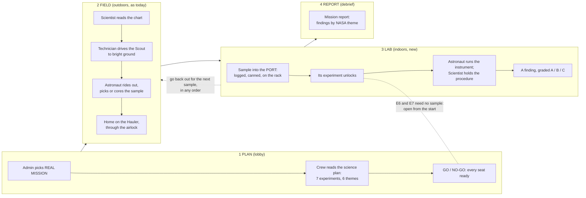

### 3.2 Who does what

The game's rule stays: **nobody has the whole picture, and only Mission Ops talks to the astronaut.** The lab is built on the same split.

| Seat | In the field (unchanged) | In the lab (new) |
| --- | --- | --- |
| **Astronaut** (headset) | Hands and eyes | **The hands on the instrument.** Sees the instrument and what it shows (a view down the eyepiece, a needle, a strip chart) but has no reference to judge it by. |
| **Scientist** | The chart and the field guide | **The principal investigator.** Holds the **procedure card** and the **reference** for each open experiment (which mineral shows which pattern, which temperature step to hold, what a good trace looks like), and gets the instrument's **telemetry** (the numbers). Does not see the instrument. Calls the result. |
| **Mission Ops** | The only voice | Still the only voice: relays the Scientist's steps to the astronaut and the astronaut's observations back. Owns the **experiment board** (which are locked, ready, running, done) and the mission tape. |
| **Technician** | Two rovers | **The base's utilities.** Instruments draw power; two of them (the furnace, the cold box) and the radio need the Technician to grant power or quieten the base. See section 6. |
| **2-player** | All three Earth seats | One simplified lab panel: the board, the current step in words, and the reference picture for the open experiment. |

### 3.3 The life of a sample

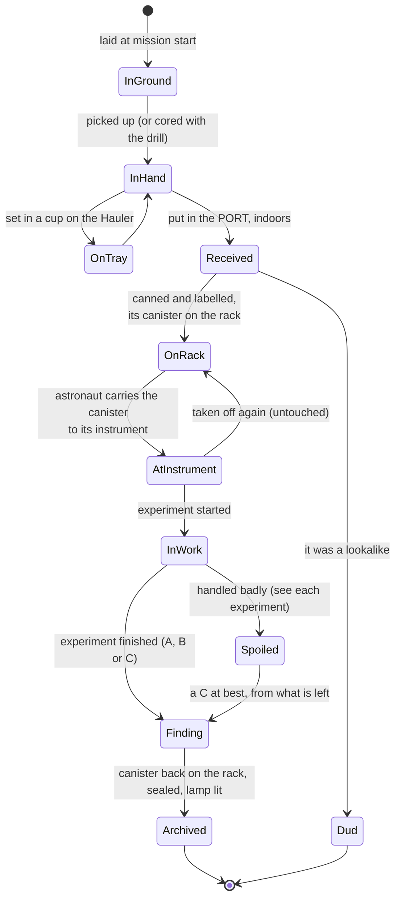

- **Received** replaces today's "banked". The port still assays the sample (FOUND or DUD), and a labelled canister appears on the rack on the end of the workbench, where the banked canisters already stand.
- A canister is a physics object like a tool: carried in one hand, set down anywhere, and it clicks into the cradle on its own instrument and no other (its cradle is cut to its glyph: diamond, dots, triangle, star, and a long slot for the core).
- A dud scores nothing and unlocks nothing, as now.

### 3.4 One experiment, end to end

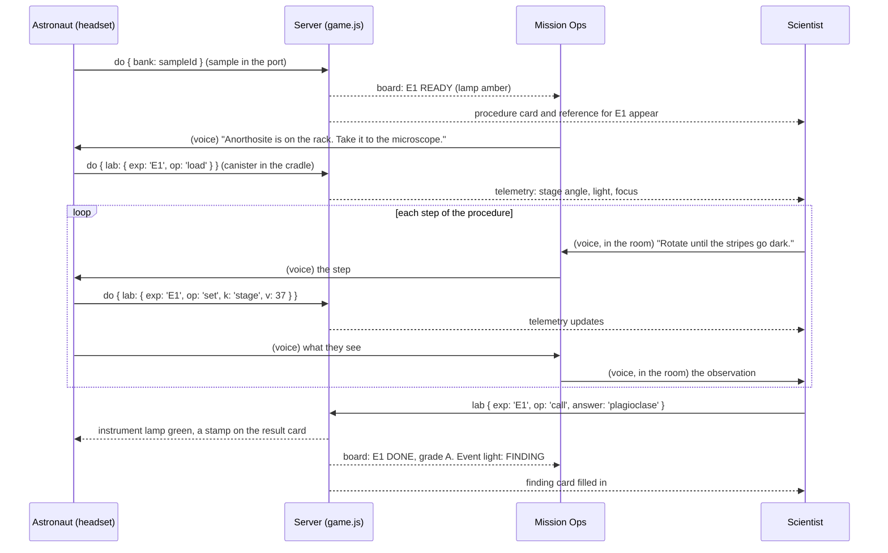

The server is the authority on every step and on the grade. The astronaut's page reports what the hands did; the Scientist's page reports the call; `game.js` alone decides what it was worth.

### 3.5 Order and time

- **Any order.** There is no chain between experiments. The only gate is "has its sample been received" (E1 to E5) or nothing at all (E6, E7).
- **One pair of hands.** The astronaut can only be at one instrument at a time, but three experiments have a **wait** in them (the furnace's heating steps, the cold box's sublimation, the receiver's recording). The intended skill is to start one, walk to another, and come back when its lamp calls: real lab work.
- **The clock.** A Real Mission is longer than the 6:00 demo. Proposed: **15:00**, with suit oxygen draining only outdoors and refilling indoors (as now), so the crew chooses how to split the time between sorties and bench work. Tunable: `CFG.real.roundSeconds`.
- **Faults.** The base still breaks, but less often (proposed: two faults in a mission, no meteor shower in the first five minutes), and a blackout now matters to the science: an instrument that loses power mid-run spoils its sample unless the Technician sheds something else first (section 6).

## 4. The lab in the hall

The hall is 7 m wide and 15 m long (`x` -3.5 to 3.5, `z` 0 to -15, north is -z). The instruments go on surfaces and walls that are free today. Positions are proposals in room coordinates, to be checked against the colliders in `client/interior.js` when it is built.

```
                         N airlock
        z -15 ┌───────────────────────┬──────┐
              │                       │ (2.5)│
              │  [E6 RECEIVER]        └──────┤
        z -13 │  west wall, -12.8        corridor
              │                              │
              │      SPARES STAND            │
        z -11 │  LIFE   (tire, gen)   [E4 COLD BOX]
              │ SUPPORT               east wall, -10.6
              │                              │
         z -9 │ [E5 CORE TABLE]              │
              │  west wall, -8.6          E airlock (z -8)
              │                              │
         z -7 │ TOOL RACK     HALL           │
              │ (brush,   ┌──────┐   [E2 ROCK CLOCK]
              │  patch)   │[E3   │    east wall, -6.3
         z -5 │           │FURNACE]          │
              │      ┌────┘      │        PORT ◄── samples come in here
              │      │ [E1 MICROSCOPE]  RACK │    (east wall, -4.6)
         z -4 │      └───── workbench ──┘(canisters)
   W airlock  │                              │
     (z -3)   │                       LOCKERS│
              │                    [E7 MED KIT]
         z -1 │                     by the lockers, -1.6
              │        window                │
          z 0 └──────────── S airlock ───────┘
             x -3.5          0             3.5
```

| | Instrument | Where (x, z) | Stands on | Built from |
| --- | --- | --- | --- | --- |
| Receiving | The **port** and the **canister rack** (both exist) | (3.24, -4.6); the east end of the workbench | Wall; bench | `sample-canister` model, one per kind, its glyph stencilled on the lid |
| E1 | Polarising **microscope** | (0.8, -4.45) | Workbench, long arm | Hand-built: brass tube on a black stand, a round stage with a degree ring, a lamp. A canvas "eyepiece" disc beside it shows the view (a headset cannot look down a tube) |
| E2 | **Mass spectrometer** console | (3.3, -6.3) | East wall, floor-standing | The `spectrograph-crate` model as its body, with a round CRT, a Nixie counter and a strip-chart recorder set into a `console` panel |
| E3 | Step **furnace** and gas analyser | (-1.55, -5.8) | Workbench, short arm | Hand-built: a lathe-turned furnace tube with a sight glass that glows `nixie` orange, a big temperature dial, a chart recorder |
| E4 | **Cold box** (a glovebox freezer) | (3.2, -10.6) | East wall | Hand-built: a frosted window, two glove ports, a balance pan inside, a thermometer dial with a blue-painted cold band |
| E5 | **Core table** | (-3.2, -8.6) | West wall | Hand-built: a long V-trough with a sliding carriage, a ruler in centimetres, a small gas cell on the carriage |
| E6 | Low-frequency **receiver** | (-3.2, -12.8) | West wall rack | A rack panel: a tuning knob with a slide-rule scale, a headphone hook, a level meter, a chart recorder. `flight-deck-panel-b.webp` as the surround |
| E7 | **Med kit** | (2.6, -1.6) | A fold-down shelf by the lockers | Hand-built: a cream enamel box with an engraved MED plate, a tube rack, a dosimeter reader with a Nixie counter |

Rules of the room (from [CLAUDE.md](../CLAUDE.md)): every instrument sits on a surface with a blob shadow, has a name tag (SPEC-guidance.md, phase 2) and a `Lamp_Status` jewel (dark = locked, amber = ready, blinking amber = waiting on you, green = done). Models first; where a shape is hand-built it is lathed or bevelled and carries a canvas texture, never a bare box. One merged mesh per instrument plus its moving parts, to stay inside the Quest's draw-call budget.

**The status board.** The hall's existing board (the flight status board from SPEC-physical-base.md) gains a seven-lamp row, E1 to E7, each under its glyph or icon, so the astronaut can see the state of the whole lab from anywhere in the hall.

## 5. The seven experiments

Each is written the same way: the real science, what the astronaut does, what the Scientist has, how it is graded, and how it can go wrong. "Laptop astronaut" is the keyboard-and-mouse fallback every station must have (the astronaut seat is playable without a headset).

Grades: **A** 300 points, **B** 200, **C** 100. A spoiled sample can still earn a C from what is left; an experiment never fails to nothing, because a new player should always get a finding.

### E1 THIN SECTION (anorthosite · how rocky worlds form)

**The real science.** Geologists grind a slice of rock to 0.03 mm, thin enough for light to pass, and look at it between two polarising filters. Each mineral shows its own colours and patterns and goes dark ("extinct") at its own angles as the stage turns. Anorthosite is nearly all plagioclase feldspar, which shows grey parallel stripes (twinning). Finding the Moon's highlands made of it is the evidence that the young Moon was a **magma ocean** whose light crystals floated to the top. *Simplified:* we skip making the slide and reduce identification to three minerals.

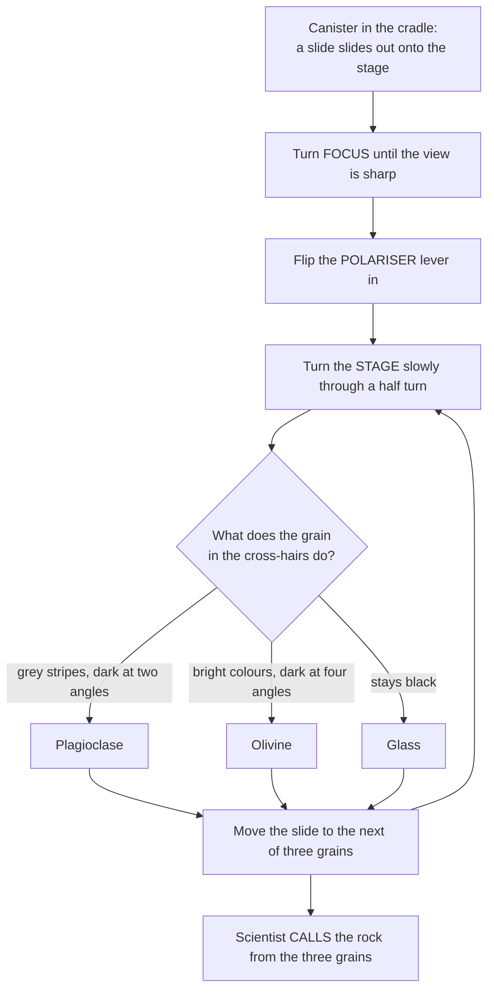

- **Astronaut:** three controls: a focus knob, a polariser lever, the stage (grab its rim and turn; a degree ring clicks every 15°). The eyepiece disc beside the microscope shows the view. Says what they see: "stripes... going dark... now".
- **Scientist:** the reference card (three pictures: what each mineral looks like and how often it goes dark in a full turn), and telemetry (stage angle, focus, polariser in or out, which grain). Presses a mineral key for each grain, then the rock.
- **Grade:** A = all three grains right and the stage turned at least 180° on each. B = two right. C = a call was made.
- **Goes wrong:** turned too fast (over 90° a second) and the view smears: slow down. No spoiling: this is the gentle first experiment.
- **Laptop astronaut:** mouse wheel on the knob under the cross-hair; drag the stage.
- **Juice:** the stage's detents click; the view snaps sharp with a soft lens "tock"; the grain blinks to black at extinction.

### E2 ROCK CLOCK (vesicular basalt · the impact record)

**The real science.** Some atoms decay at a known rate (potassium-40 to argon-40, for one). Measure parent and daughter in a rock and you know how long ago it froze. Apollo's dated lavas are what turn "this surface has more craters than that one" into ages in years, and the same crater clock is then used on Mars. *Simplified:* one decay pair, a clean reading, and a slide rule that does the arithmetic.

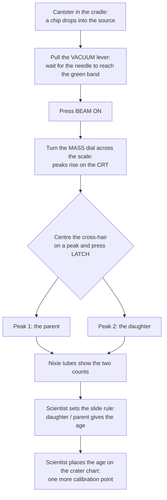

- **Astronaut:** a vacuum lever, a beam button, a mass dial, a latch button. The CRT (phosphor) shows a trace with peaks that sharpen as the dial centres on them.
- **Scientist:** which two masses to find (the card), the two counts as they latch, and a **slide rule** on the desk: drag its slider to the ratio and read the age in billions of years. Then a chart of craters-per-area against age, with Apollo's points on it: place the new point.
- **Grade:** A = both peaks latched within 2% of their centres and the age within 0.1 billion years. B = within 5% and 0.3. C = an age was called.
- **Goes wrong:** BEAM ON before the vacuum is good **burns the filament**: the instrument is dead for 30 s and the best grade falls to B. Latching the wrong peak gives a silly age (the Scientist should notice it is older than the solar system).
- **Wait:** 10 s for the vacuum.
- **Juice:** the vacuum pump's rising hum; the CRT trace has afterglow; a relay clack on LATCH.

### E3 FIRE FOUNTAIN (orange glass · water and other materials)

**The real science.** Apollo 17's orange soil is tiny glass beads sprayed out by volcanic fire fountains 3.5 billion years ago. Decades later, water and other volatiles were found locked inside them: evidence that the Moon's interior is not bone dry. Heat a sample in steps and each gas comes off at its own temperature. *Simplified:* three steps and three gases.

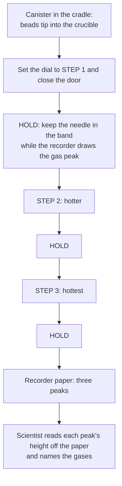

- **Astronaut:** a temperature dial (a big Bakelite knob), a door, and the job of **holding**: the furnace drifts, and the needle has to be nudged back into each step's band while the pen draws. The sight glass glows from dull red to `nixie` orange.
- **Scientist:** the three bands (from the card: they are not marked on the astronaut's dial), the live temperature, and the strip chart. Reads off the three peak heights and tells Ops the next step.
- **Technician:** the furnace is the base's biggest load: it will not heat until the Technician grants it power (section 6).
- **Grade:** A = the needle in band for at least 90% of all three holds. B = 70%. C = finished.
- **Goes wrong:** overshooting a step by more than a band's width **boils off the next step's gas early**: that peak is lost and the best grade is B. Opening the door hot loses the step in progress.
- **Wait:** each hold is 12 s; the furnace keeps its temperature for 20 s unattended before it drifts out, which is the window to go and do something else.
- **Juice:** the furnace ticks as it heats; the pen scratches; a chime when a hold completes; heat shimmer is a `toneMapped: false` glow, not a shader.

### E4 COLD TRAP (ice-bearing clod · water and other materials)

**The real science.** Craters near the Moon's poles that never see the Sun are among the coldest places in the solar system, and hold water ice. How much there is, and where it came from (comets, asteroids, the solar wind, the Moon itself), is one of the largest open questions, and the answer decides whether a base can make its own water, air and fuel. The ratio of heavy to light hydrogen (D/H) is the fingerprint of the source. The hard part is practical: **the sample must never warm up.** *Simplified:* one fingerprint reading, three possible sources.

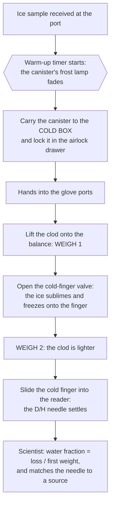

- **Astronaut:** the only experiment with a clock on the **sample**. From the port, an ice canister has **90 s** before it starts to lose water; its frost-blue lamp fades as it warms. In the box: put both hands through the glove ports (the gloves in the box follow the controllers), lift the clod onto the pan, open a valve, wait, weigh again, move the cold finger.
- **Scientist:** the two weights on Nixie tubes, the D/H needle, and a card with three marked bands (comet, asteroid, solar wind). Works out the water fraction and names the source.
- **Technician:** the cold box needs power to stay cold. If the base goes dark, it holds for 40 s.
- **Grade:** A = into the box inside 90 s, both weighings steady (hands still for 2 s), source right. B = up to 150 s, or one shaky weighing. C = finished (a warmed sample still has *some* water).
- **Goes wrong:** warm-up loses water (the reading is low, and the Scientist can say so: a real result with a real caveat). Opening the box's outer drawer while the valve is open lets the vapour out: redo the sublimation, best grade B.
- **Wait:** 15 s of sublimation.
- **Juice:** frost creeps on the window; breath-like vapour when the valve opens; the balance needle swings and settles.
- **Order note:** this is the one experiment that punishes "bank everything, then do the lab". The crew learns to plan the ice run for when the astronaut can go straight to the box. That is the planning lesson, and it comes from the science.

### E5 SUN RECORD (drill core · the history of the Sun)

**The real science.** The Moon has no air and no magnetic field, so the solar wind hits the ground and its atoms lodge in the soil grains. Impacts bury old soil under new. A core through the layers is a tape recording of the Sun running back through time: deeper is older. *Simplified:* five layers, one gas, and the layers are visibly different.

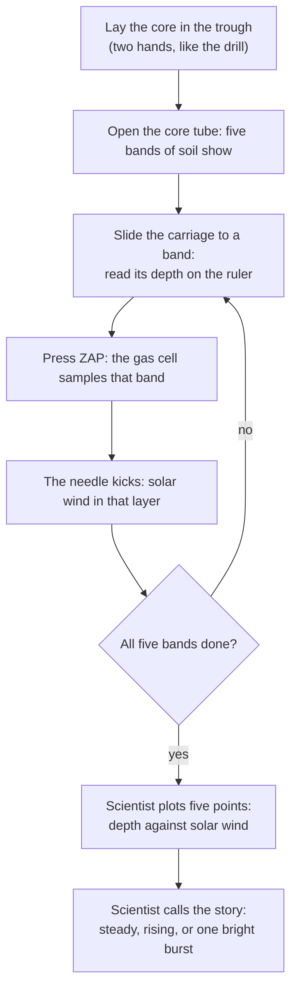

- **Astronaut:** slide the carriage along the ruler to each band in turn, hold it still on the band's centre, press the button. Reads out the depth and the kick.
- **Scientist:** a graph with depth down the side. Each ZAP sends a point; the Scientist places it (drag to the depth the astronaut read out) and, after five, picks the story the curve tells.
- **Grade:** A = all five bands sampled within 5 mm of centre, story right. B = four good bands. C = finished.
- **Goes wrong:** sampling on the boundary between two bands gives a blurred reading (a point between the two true values). **Tipping the trough** (knocking it, or lifting an end) mixes the layers: the record is scrambled and the best grade is C. The core is the most fragile thing in the lab, as it is in life.
- **Juice:** the carriage runs on a rack with a ratchet sound; ZAP is a small spark and a needle kick; soil bands have different grain and tone from the palette's `regolith` range.

### E6 QUIET SKY (no sample · a new window on the universe)

**The real science.** Radio waves below about 30 MHz from the early universe (the "dark ages" before the first stars) never reach telescopes on Earth: the ionosphere blocks them and our own transmitters drown them. The far side of the Moon is the quietest radio site there is. NASA's LuSEE-Night pathfinder is going there to try. The catch for a crewed base: **the base itself is noisy.** *Simplified:* our base is not on the far side; the experiment is the pathfinder's question in miniature: how quiet can we make it?

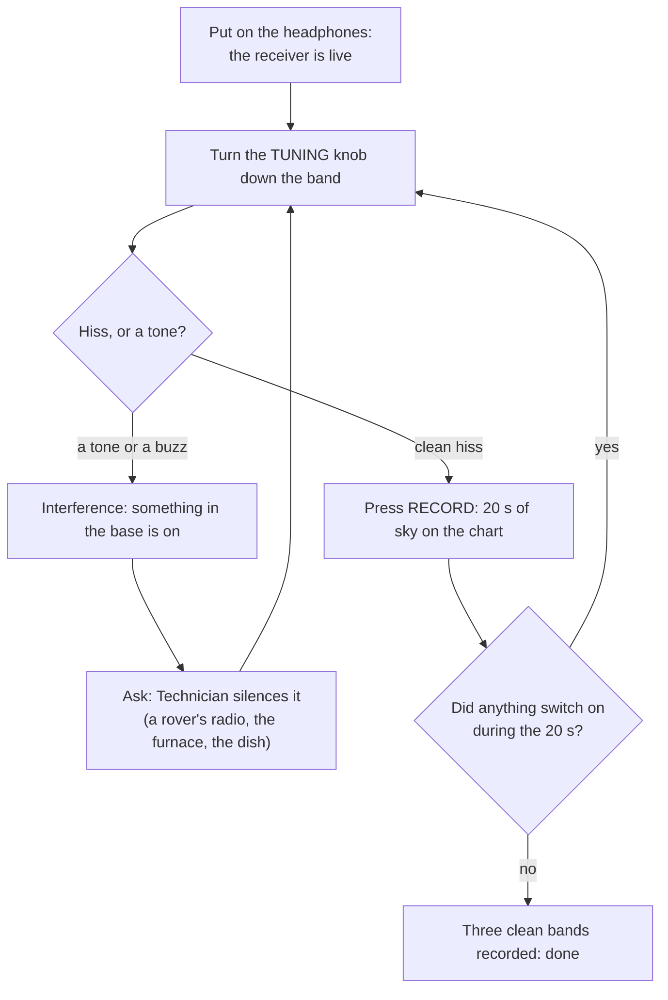

- **Astronaut:** headphones (positional audio becomes head-locked), a tuning knob with a slide-rule scale, a RECORD button. Hears hiss, and interference as tones: each noisy system has its own sound.
- **Technician:** a **RADIO QUIET** panel: a lamp and a switch for each noisy system (Scout radio, Hauler radio, the dish, the furnace, the cold box's compressor). Quieting a rover stops it where it stands; the dish going quiet cuts the Scientist's telemetry for those seconds. The Technician has to choose *when* the base can afford to be quiet.
- **Scientist:** the three bands wanted and the chart as it records.
- **Grade:** A = three clean 20 s recordings. B = two. C = one.
- **Goes wrong:** anything switching on mid-recording spoils that recording only.
- **Why it matters to the loop:** it is the one experiment the crew does *around* everything else. It cannot run while the furnace or the rovers do. It teaches that instruments compete, which is most of real mission planning.

### E7 CREW HEALTH (no sample · learning to live and work on the Moon)

**The real science.** On Artemis II the crew collected their own saliva for the Immune Biomarkers study, to be analysed for "biomarkers that monitor immunity, inflammation, nutritional status, bone health, and radiation effects". A Moon base makes this routine: the crew is also the experiment. *Simplified:* two collections and a dosimeter, no chemistry.

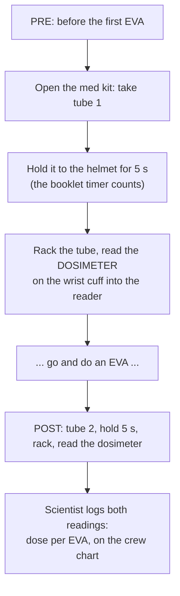

- **Astronaut:** twice in the mission (once before going out at all, once after any EVA), take a tube from the kit, hold it at the helmet's mouth for 5 s, rack it, and press the wrist cuff to the reader. The cuff gains a small dosimeter window (a number that creeps up outdoors, faster during a meteor shower's aftermath, never to a harmful level: it is a measurement, not a hazard).
- **Scientist:** logs the two doses and the EVA time between them.
- **Grade:** A = the PRE sample taken before the first step outside and the POST within 60 s of coming back in. B = both taken, late. C = one taken.
- **Goes wrong:** forgetting the PRE sample before going out (the most realistic failure in the whole lab: a baseline you cannot go back for). Best grade is then C.
- **Why it is here:** it is 20 seconds of play, it is the first thing a new astronaut can succeed at, and it makes the point that human research is a science theme, not an afterthought.

### The experiments at a glance

| | Sample | Skill | Has a wait | Sample has a clock | Needs the Technician | Hands |
| --- | --- | --- | --- | --- | --- | --- |
| E1 Thin section | Anorthosite | Look and describe | | | | 1 |
| E2 Rock clock | Basalt | Tune precisely | 10 s | | | 1 |
| E3 Fire fountain | Orange glass | Hold steady | 3 x 12 s | | Power | 1 |
| E4 Cold trap | Ice | Be quick, then still | 15 s | 90 s | Power | 2 |
| E5 Sun record | Core | Be careful | | | | 2 to load |
| E6 Quiet sky | None | Coordinate | 3 x 20 s | | Radio quiet | 1 |
| E7 Crew health | None | Remember | | Before the first EVA | | 1 |

## 6. The Technician and the base's utilities

Mission design is deciding what you cannot do at the same time. The lab gives the Technician the levers:

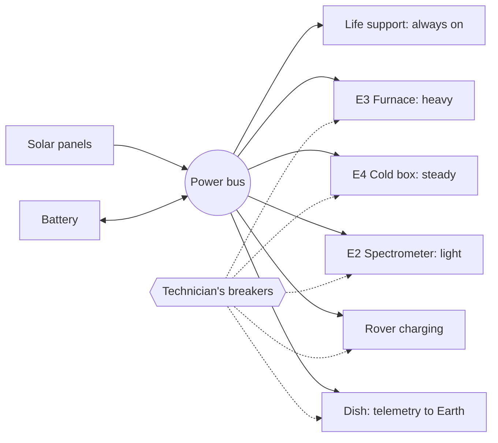

- A **breaker panel** on the Technician's desk (a column on the pillar between the monitors): one lit breaker per load, and a bus meter with a red band. More load than the bus can carry drains the battery; a flat battery is the blackout that exists today.
- **Dusty panels** (the existing fault) now have a visible cost: the bus cannot carry the furnace until they are brushed.
- **RADIO QUIET** (E6) is the same panel read the other way: breakers off make the base quiet.
- The Technician is told nothing about what the instruments are doing, only what they draw. To know whether it is safe to pull the furnace's breaker they have to ask.

This is the smallest change that gives the fourth seat a part in the lab. It can be cut without touching the experiments (section 11, D6).

## 7. Mission Control's desks

Additions to the desks of [design/mission-control-consoles.md](design/mission-control-consoles.md). Same frame, same palette, pictures over captions.

**Scientist: a fourth page on the auxiliary display, key 4, LAB.**

```
┌ LAB ───────────────────────────────────────────────┐
│ ◆ E1   ⠿ E2   ▲ E3   ✶ E4   ▮ E5   ◠ E6   ✚ E7    │  seven tiles: dark / amber / blink / green
├────────────────────────────────────────────────────┤
│  PROCEDURE (cream card, numbered pictures)         │
│   1 [focus]  2 [polariser]  3 [turn stage]  4 ...  │  the step in progress is ringed
├───────────────────────────┬────────────────────────┤
│  REFERENCE                │  TELEMETRY             │
│  three mineral pictures,  │  STAGE  0 3 7  deg     │  Nixie
│  each with its count of   │  FOCUS  ▕▔▔▲▔▏         │  edgewise meter
│  dark angles per turn     │  POL    ● in           │  lamp
├───────────────────────────┴────────────────────────┤
│  CALL:  [plagioclase] [olivine] [glass]            │  lit push-buttons
└────────────────────────────────────────────────────┘
```

(The glyphs in the sketch stand for canvas icons; nothing here is an emoji in the game.) The survey scope stays on screen on the left, as now.

**Mission Ops: the SAMPLES panel becomes the experiment board.** The flow hands → tray → bank grows a fourth stage: seven tiles, one per experiment, with its grade letter once done. The mission tape marks each finding. The teletype line gives the next sensible step in words ("ICE IS ON THE RACK. COLD BOX IN 90 S.").

**Technician: the breaker column** of section 6.

**Event lights.** The eighth light (NO LINK) stays; SAMPLE BANKED is relabelled in meaning to "sample received", and a ninth light, FINDING (a flask icon, green), is added for a completed experiment. Nine fit the strip at 30 px.

**2-player desk.** The right-hand column's field guide gives way, while an experiment is running, to that experiment's reference picture and call buttons; the seven tiles sit under the scope. No procedure card: the teletype line carries the step.

## 8. Mode, rules, state

### 8.1 The mode and the admin console

- `MODES` gains `real: 'Real mission'`.
- A new list, `ADMIN_MODES = ['real']`, marks modes that only the admin console may set. The lobby's mission picker (`renderPlan` in `client/console.js`) lists `MODES` without them. `hub.js` already has two paths: `m.cmd === 'mode'` from the admin and `m.t === 'mode'` from Mission Ops; the second refuses an admin-only mode.
- The admin's Mode menu gets the third entry. With `real` selected, the admin panel shows the mission's options: length (10, 15 or 20 minutes), faults (off, light, as demo), and which experiments are in play (seven checkboxes, all on), so a facilitator can run a short classroom mission with three.
- The lobby shows which mission is loaded (a plate reading REAL MISSION on the briefing sheet), but cannot change it.

### 8.2 Winning

There is no single win. The debrief reports **science return**:

| Result | Condition (proposed) |
| --- | --- |
| **Full science return** | A finding in all six themes (E3 or E4 covers the water theme) |
| **Mission success** | Findings in at least four themes, and the astronaut alive |
| **Partial return** | At least one finding |
| **Mission failed** | Suit oxygen ran out, or no finding |

Score = sum of grades, plus the existing oxygen bonus. Extra samples beyond what the experiments need are worth what they are today.

### 8.3 State (sketch, for the design doc to firm up)

```js
// server/game.js, only in mode 'real'
this.lab = {
  E1: { state: 'locked' | 'ready' | 'loaded' | 'running' | 'done', sample: id | null,
        step: 0, vars: { stage: 0, focus: 0.2, pol: false, grain: 0 }, calls: [], grade: null, spoiled: false },
  // E2 ... E7 the same shape, each with its own vars
};
this.bus = { load: 0, cap: 0, breakers: { furnace: false, coldbox: true, spec: true, rovers: true, dish: true } };
```

Wire, new messages only:

| From | Message | Meaning |
| --- | --- | --- |
| Astronaut | `do { lab: { exp, op: 'load' \| 'unload' \| 'set' \| 'press', k, v } }` | A canister in a cradle, a control moved, a button pressed |
| Scientist (or `all`) | `{ t: 'lab', exp, op: 'call', answer }` | The call that ends an experiment (or a step of one) |
| Technician (or `all`) | `{ t: 'breaker', id, on }` | A breaker thrown |

What each seat's `view()` gains, and no more:

| Seat | Gets |
| --- | --- |
| Astronaut | `lab[exp].{state, step, shows}`: what the instrument displays (the eyepiece picture's parameters, a needle, a lamp), never the reference or the right answer |
| Scientist | `lab[exp].{state, step, vars, card}`: telemetry and the reference, never the picture the astronaut sees |
| Mission Ops | `lab[exp].{state, grade}` |
| Technician | `bus`, and each load's draw |

The asymmetry is the game: the astronaut sees *what*, the Scientist knows *what it means*, and the only way to put the two together is to talk.

### 8.4 Checks

- `npm test`: the rules of each experiment as pure functions of actions (a perfect run grades A; each "goes wrong" caps the grade as written; an experiment cannot start before its sample is received; `real` cannot be set from a seat).
- `npm run smoke`: a laptop astronaut completes E7 and E1 in a real mission started from the admin console.
- `npm run vr:shots`: one picture of each instrument in the headset, checked against DESIGN.md.

## 9. The rest of the loop, and the Space Apps challenge

⚠ **Unverified.** The challenge page could not be read (see "Sources"). What follows assumes the "Space Mission Design Game" challenge asks for a game in which players **design and carry out a space mission**: setting objectives, choosing what to take and what to do under limits (mass, power, time, money, risk), living with the trade-offs, and learning real space science and engineering on the way, with NASA's open data and missions as the source material. **Check each row against the challenge's own objectives and "potential considerations" before acting on it**, and strike what does not apply.

Where the game stands against that reading:

| ⚠ Likely ask | Today | With the lab (sections 1 to 8) | Still missing |
| --- | --- | --- | --- |
| Players **design** a mission, not only fly one | The mission is fixed; the crew only executes | The crew chooses the order and the split of time | A planning step with real choices (9.1) |
| **Constraints and trade-offs** | Oxygen and the clock | Sample clocks, power, radio quiet: instruments compete | Mass and crew time as budgets (9.2) |
| **Real science and real missions** | Real sample types, NASA models, LOLA terrain | Seven experiments tied to NASA's six Moon Base themes | Fact cards and sources in the game (9.5) |
| **Teaches something** | Teamwork under comms limits | What each analysis is for | A debrief that explains (9.4) |
| **Playable by judges** | Needs four people and ideally a Quest | The same | A way to play alone, quickly (9.6) |

### 9.1 A planning phase: the science plan (recommended, the biggest gap)

Before GO, the crew builds the mission on one screen, each seat owning one decision, so the plan is argued over aloud:

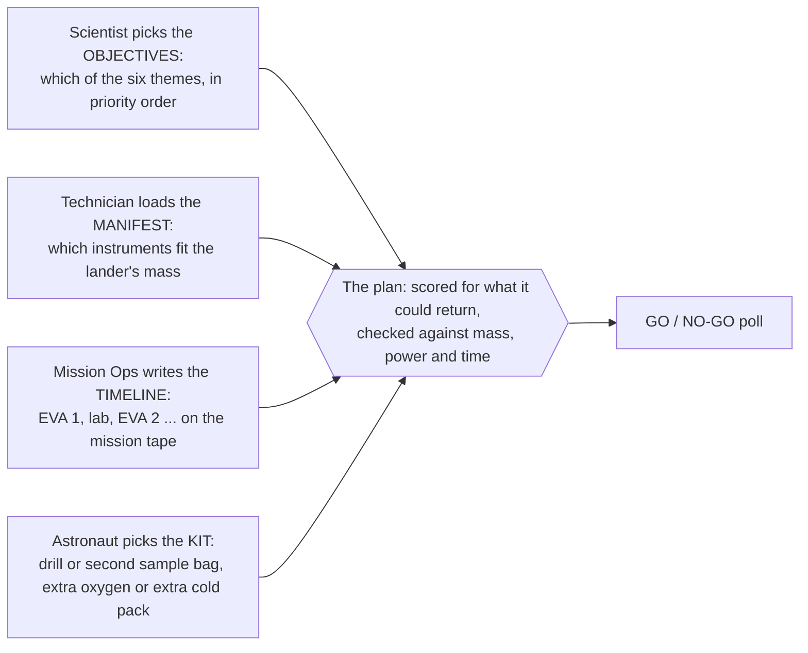

- **Mass budget.** Each instrument has a mass; the lander carries so much. You cannot bring all seven. Leaving the furnace at home frees mass for a second cold pack (a longer ice clock). This is the heart of a mission design game: the plan decides which findings are even possible.
- **The plan is the yardstick.** The debrief compares what was planned with what was returned. A modest plan fully delivered should beat an ambitious one half done.
- Scope: this is a pass of its own (lobby content, not lobby restyling: the plan lives on the briefing sheet, which is ours to change).

### 9.2 Budgets as instruments

Keep them few and physical, on the desks that already exist: **power** (the bus meter, section 6), **crew time** (the mission tape, with the plan drawn on it as a second track so drift is visible), **consumables** (suit oxygen, now with a per-EVA allowance set in the plan), **mass** (planning only), **data** (9.3).

### 9.3 Downlink windows

Findings are not "returned" until they are sent. The dish has passes (a bar on Mission Ops' tape); a finding made outside a pass waits in a buffer of three. It gives Ops a real scheduling job and gives E6 its tension (the dish is noisy).

### 9.4 GO / NO-GO, and a debrief that reads like a mission report

- **Polls.** Before each EVA, Ops polls the room (a lit key per seat) as flight directors do. A NO-GO from any seat holds the airlock. It costs seconds and makes the crew say out loud what they are about to do.
- **The report.** One page per theme: the finding, its grade, the plan's target, and two sentences of what the real result was and which mission found it, with the source named. This is where the game teaches, after the pressure is off.

### 9.5 Real data, named

Space Apps rewards use of NASA's open data. We already use LOLA terrain and NASA models; say so in the game (a SOURCES plate on the briefing sheet), and consider: sample pictures from the Apollo sample catalogue for the microscope's grains; LRO images for the chart's "orbital survey"; real Apollo ages on E2's crater chart; the Artemis III candidate regions as selectable landing sites that change which samples are common.

### 9.6 Playable alone, in five minutes

A judge will not have four people and a headset. A **solo lab** entry on the admin console: the laptop astronaut, indoors only, with samples already on the rack and the Scientist's reference shown on a clipboard in the world (held in the left hand). It doubles as the tutorial and as the classroom mode.

### 9.7 Smaller ideas

- **Risk has a cause.** In the plan, cheaper choices raise a named risk (no spare tire: a wheel fault ends rover trips). Faults are then consequences, not weather.
- **Curation.** The return capsule holds three canisters. At the end the Scientist chooses which samples go to Earth: a last trade-off, worth points by theme priority.
- **Sites.** Two or three landing sites with different sample mixes (polar: more ice, harder light; mare: more basalt), chosen in the plan.
- **Roles named for real consoles** on the briefing card only: CAPCOM (Ops), SURFACE/ROVER (Technician), SCIENCE (Scientist), EV1 (astronaut).

## 10. Phasing

Each step is playable and mergeable on its own.

| | Step | Gives |
| --- | --- | --- |
| 1 | The mode, the admin menu, "received" in place of "banked", canisters as objects, the status board, E7 and E1 | A Real Mission that can be started and has two experiments end to end |
| 2 | E2 and E5 (no utilities needed) | Four experiments, five themes |
| 3 | The power bus and breakers; E3 and E4 | The waits, the ice clock, the Technician's part |
| 4 | E6 and RADIO QUIET | All seven; the cross-seat experiment |
| 5 | The mission report debrief | The teaching |
| 6 | The planning phase (9.1) and whichever of 9.2 to 9.7 survive review | The "design" in mission design |

## 11. Decisions to review

| | Decision | Why | Overturn → |
| --- | --- | --- | --- |
| D1 | **Seven experiments, one per NASA theme** (water gets two). | The NASA page gives six themes; each should be playable. | Four, one per sample kind only (E1 to E4), for a first build. |
| D2 | Two experiments (**E6, E7**) need no sample. | Something to do in the lab from the first second, and two themes that are not about rocks. | Samples only: drop E6 and E7. |
| D3 | The **astronaut does, the Scientist knows**: the reference is never in the headset. | It is the game's existing rule, and it makes every experiment a conversation. | Put a clipboard in the lab so the astronaut can work alone (needed anyway for 9.6). |
| D4 | **Every experiment ends in a finding**, at worst a C. | New players should not lose a sample they spent five minutes fetching. | A spoiled sample is lost; go and get another. |
| D5 | **The ice has a 90 s clock** from the port. | It is the real constraint, and the one that forces planning. | No clock; or the clock starts in the field. |
| D6 | The **Technician gets the power bus** and radio quiet. | Otherwise the fourth seat has nothing to do indoors. | Cut section 6: the furnace and cold box are always powered, E6 loses its interference. |
| D7 | A Real Mission is **15 minutes**. | Three sorties and seven experiments do not fit in six. | 10 or 20; admin option either way. |
| D8 | **"Banked" becomes "received"**, only in this mode. Demo and Free play are untouched. | Two modes must keep working as they are. | Make the lab part of every mode. |
| D9 | The mode is **admin-only**, by a list the lobby filters on. | As asked; and a facilitator should choose a 15-minute mission on purpose. | Offer it in the lobby once it is stable. |
| D10 | The **eyepiece is a disc beside the microscope**, not a view down the tube. | A headset cannot be put to an eyepiece. | A magnified view when the head comes within 20 cm of the tube. |

## 12. Out of scope

- Anything outdoors: no new sample kinds, no new field tools, no change to the rovers or the chart.
- Restyling the lobby. (9.1's plan lives on the briefing sheet.)
- Real chemistry or physics simulation: every instrument is a small state machine with a picture on it.
- Voice between seats other than through Mission Ops.

## 13. As built (E1 to E4)

The first build covers the four experiments that each kind of sample opens: one finding per specimen, across three of NASA's themes (planetary processes, impact history, volatiles). Run it with `npm run lab` (`npm run lab:shots` for pictures in `test/shots/lab/`).

| Piece | Where |
| --- | --- |
| The experiments' shared numbers (bands, peaks, sources, places, the grain pictures) | `client/shared/lab.js` |
| The rules: what each key does, the clocks, the grades | `server/lab.js`, driven by `server/game.js` (`labCall`, `setBreaker`, `labReady`) |
| The mode, admin-only | `MODES.real` and `ADMIN_MODES` in `client/shared/config.js`; `server/hub.js` refuses it from a seat; the lobby's picker leaves it out |
| The instruments in the hall | `client/lab.js`, added to the astronaut page beside the fixtures |
| The Scientist's LAB page (key 4) | `client/console/lab.js`, drawn by `client/console/sci.js` |
| Mission Ops' four tiles, the Technician's two breakers, the 2-player desk's lab view (key L) | `client/console/ops.js`, `tech.js`, `all.js` |
| The FINDING event light, the teletype lines, the briefing rows | `client/console/desk.js`, `client/shared/guide.js` |
| Tests | `test/game.test.js` and `test/hub.test.js` (the rules), `test/lab.mjs` (all four through the real pages) |

What each experiment asks, as built:

| | The astronaut's keys | The Scientist's call | A | B |
| --- | --- | --- | --- | --- |
| E1 THIN SECTION | LOAD, FOCUS − +, POL, STAGE ◄ ►, NEXT GRAIN | A mineral for each of the three grains | All three right, each turned 180° with the polariser in and in focus | Two right |
| E2 ROCK CLOCK | LOAD, PUMP, BEAM, MASS − +, LATCH | The age, read off the slide rule from the two latched counts | Peaks 39 and 40 latched within 0.05, age within 0.1 billion years, filament never burnt | Within 0.15 and 0.3 |
| E3 FIRE FOUNTAIN | LOAD, SET − +, DOOR | The water peak's height: LOW, MED or HIGH | Right, needle in band 90% of the holds, no gas lost | Right, 70% |
| E4 COLD TRAP | LOAD, WEIGH (held), VALVE, READER | The source of the water: solar wind, asteroid or comet | Right, in the box within 90 s, both weighings steady | Right, within 150 s or steady |

Anything else is a C: every run ends in a finding. A finding is 300, 200 or 100 points and lights FINDING on every desk. All four done ends the mission, won; at the end of the clock it is won with two findings or more.

Pictures from `npm run lab:shots` (the astronaut's view at each instrument, the Scientist's LAB page, Mission Ops' four tiles under SAMPLES):

| | |
| --- | --- |
| 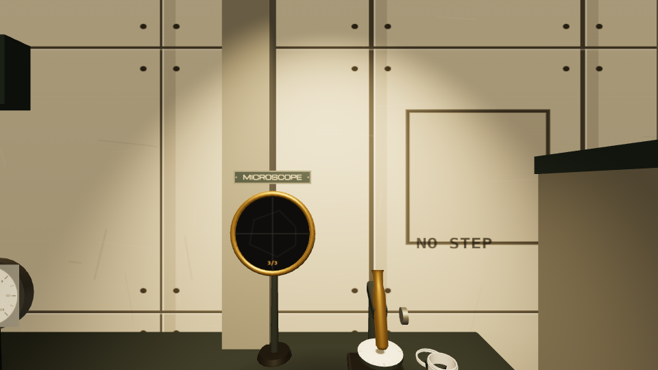 | 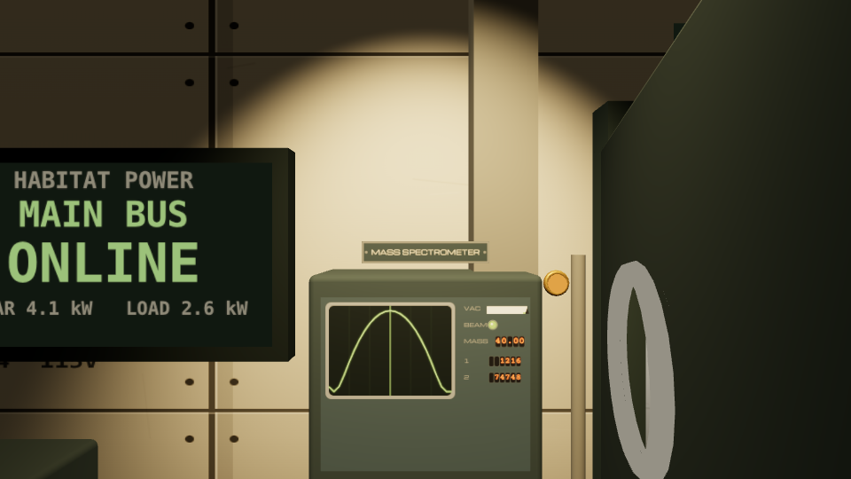 |
| 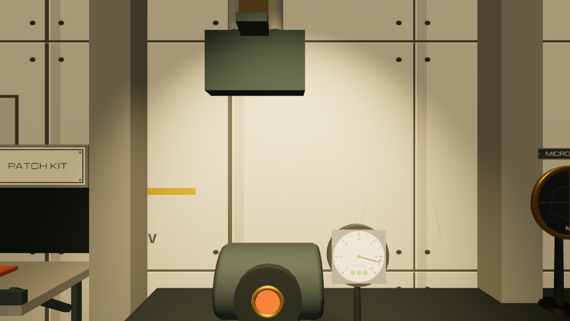 | 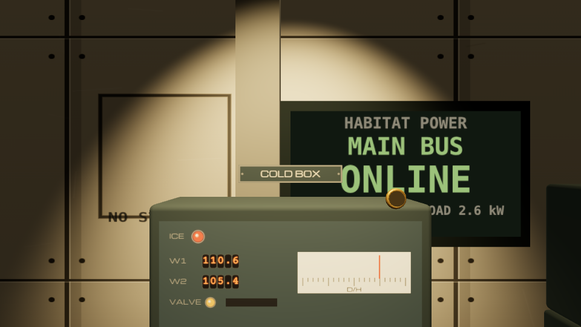 |

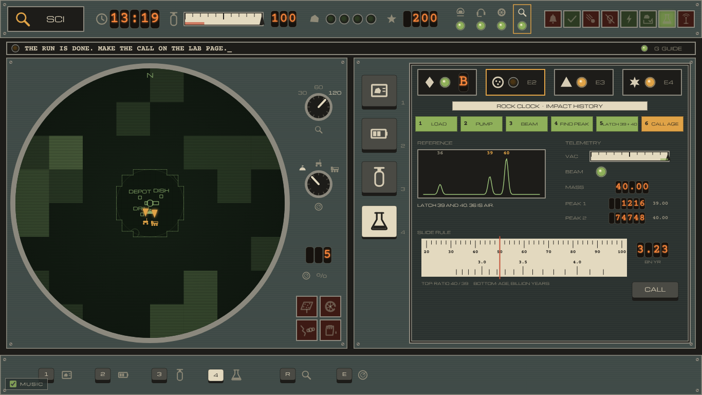

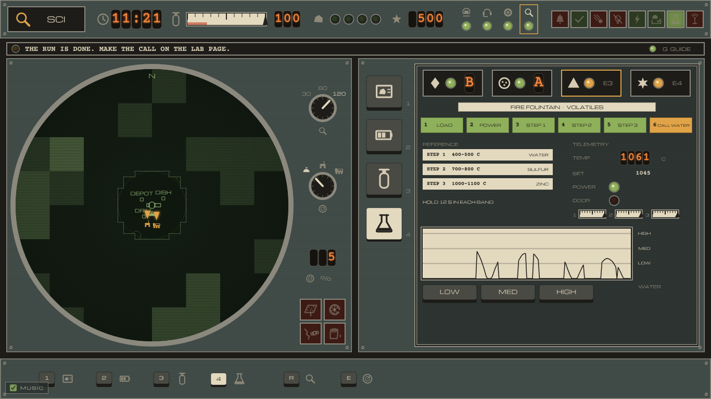

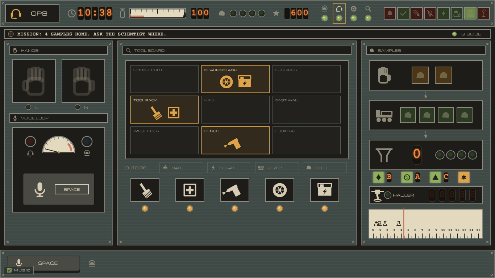

**Amendments** (each changes a section above):

- **A1** (3.3, 3.4): the canister is not carried. A sample that comes through the port opens its experiment, and LOAD at the instrument brings its canister to the cradle. Carrying a canister needs the sample-in-hand code to work indoors on benches; it is the next step if the play wants it.
- **A2** (4): the instruments moved to where the hall has room. A new lab bench on the west wall (x -3.5 to -2.85, z -10.05 to -7.15) holds the microscope (z -9.35) and the furnace (z -7.85); the mass spectrometer (z -9.25) and the cold box (z -10.85) stand against the east wall. They are in `SOLIDS`. The status board's row of lamps is not built; each instrument has its own `Lamp_Status`.
- **A3** (D8): the lab furniture is in the hall in every mode, dark outside the Real Mission. The rules of Demo and Free play are untouched.
- **A4** (5, E1): the call is a mineral per grain, not a rock. A turn counts only with the polariser in and the view in focus. The eyepiece is a round screen on a post beside the microscope (D10).
- **A5** (5, E2): the method is 40Ar/39Ar dating: peaks at argon masses 36 (air), 39 and 40, and age = ln(1 + R / 10) / 0.554 billion years for the ratio R of 40 to 39. The slide rule is a ratio scale over an age scale with a cursor the Scientist sets.
- **A6** (5, E3; 6): the power bus is two breakers on the Technician's pillar, FURN and COLD. The furnace runs the battery down at about 0.5% a second net while it is on (a full battery lasts a little over three minutes of furnace), and switches itself off when its run is done. The 2-player seat throws them from its lab view.
- **A7** (5, E4): a steady weighing is the WEIGH key held for 2 s. The cold box holds the ice cold for 40 s without power.
- **A8** (8.2): won with at least two of the four findings (`CFG.real.win`), or at once with all four.
- **A9** (9.6, in part): the admin console has a "Samples on the lab rack" button in a running Real Mission: one sample of each kind arrives as if brought home, for a demonstration or a solo lab. It scores nothing.
- **A10** (3.5): the faults in a Real Mission are dusty panels and a hull breach (`SCRIPTS.real`), the first after five minutes. The round is fifteen minutes (`CFG.real`).

