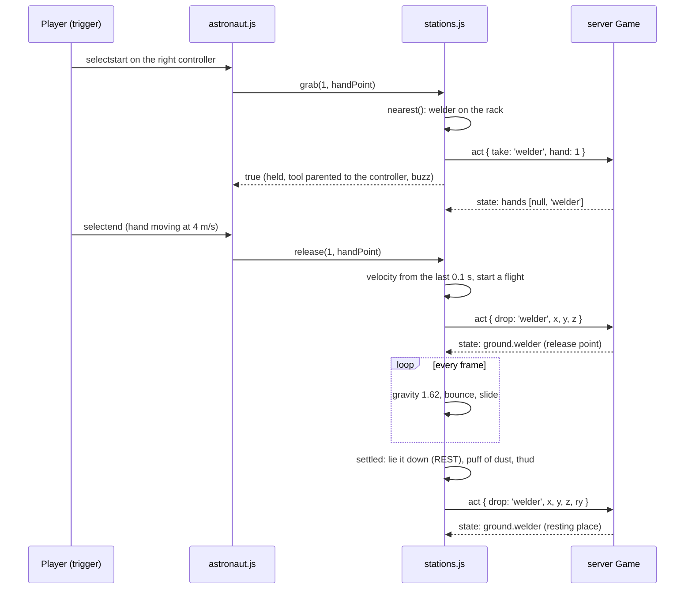
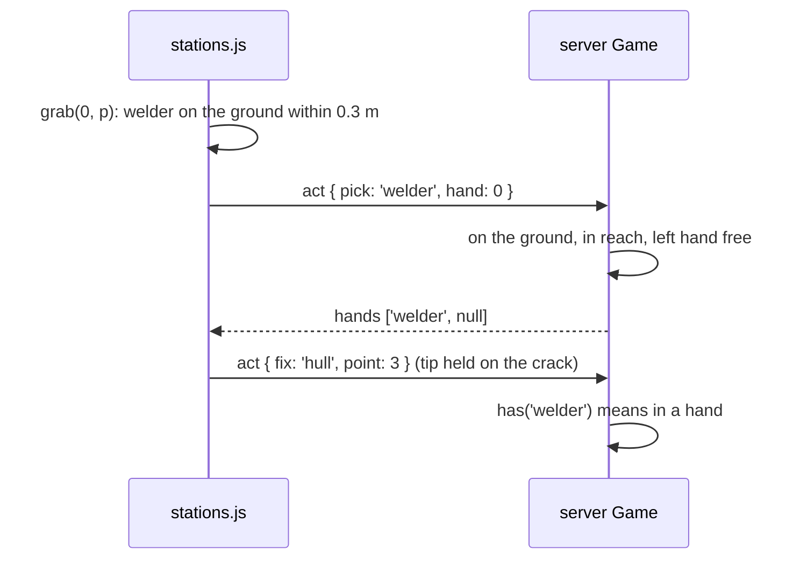
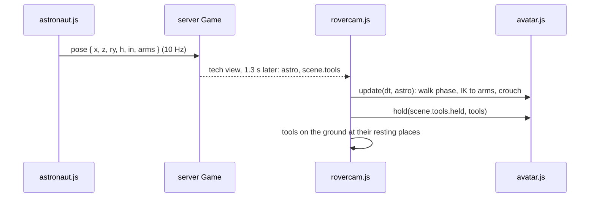

# Design: hands, throwing and an animated astronaut

Spec: [../specs/hands-and-avatar.md](../specs/hands-and-avatar.md). Process: [../WORKFLOW.md](../WORKFLOW.md).

## 1. Reading of the spec

| | Requirement |
| --- | --- |
| R1 | The rover-camera astronaut is posed, not a T-pose: arms down at rest. |
| R2 | It walks (legs and arms swing in step) when the astronaut moves, and stands still with a slight idle sway when they do not. |
| R3 | It crouches (knees bend, body lowers) when the player's head drops, instead of being squashed. |
| R4 | Its arms reach toward where the player's hands are, when the headset tracks them. |
| R5 | It holds the tools the player holds, in the matching hand. |
| R6 | In VR, holding a controller's trigger on a tool puts that tool in that hand; releasing the trigger lets go at once. |
| R7 | A tool let go keeps the hand's velocity: it flies, falls at 1.62 m/s², bounces, slides and comes to rest on the ground. |
| R8 | A tool is in exactly one of: the locker rack (until first taken), a hand, or the ground (at its resting place). |
| R9 | A tool on the ground (or still in flight) can be picked up again with either hand. |
| R10 | One tool per hand. |
| R11 | The belt is gone: nothing at the waist, the weight limit is gone, nothing snaps back. |
| R12 | Tools lying on the ground outdoors show in the rover camera. |
| R13 | Mission Ops sees what is in each hand, what is lying out, and what is still in the locker. |
| R14 | The demo mission can still be won on a laptop. |

## 2. Decisions (review these first)

| | Decision | Why | Overturn → |
| --- | --- | --- | --- |
| D1 | The **grip button grabs too**, as it does now; the trigger is added. A trigger with nothing grabbable in reach keeps its old job (right: point and use, left: radio). | The spec asks for the trigger; taking the grip away breaks muscle memory and `npm run vr`. Grabbing only wins when something is in reach. | Trigger only: delete the `squeeze*` listeners. |
| D2 | **No putting tools back on the rack.** Letting go at the locker drops the tool on the ground there. | The spec's three places; "nothing snaps back". | Add a `stow` act back when the hand is let go inside a rack slot's outline. |
| D3 | **The weight limit is removed** (`TOOLS[].weight`, `beltCapacity`, `fits`, `beltWeight`). Two hands is the limit: the welder and brush means no patch kit. | One tool per hand already forces the same choices the weights did. | Keep weights and refuse a heavy tool unless the other hand is empty. |
| D4 | The **server is told where a tool came to rest**; it does not simulate the throw. The client sends `drop` on release (where the hand was) and again on landing (where it lies). | The physics is cosmetic and only the astronaut sees it live. The server only needs "on the ground, here" for reach checks and the views. | Server-side ballistic simulation. |
| D5 | **The generator must be on the ground** for its cord to be pulled ("set it down", SPEC-v2). | It is what the spec says, and the throw makes setting it down a natural act. | Allow pulling with the generator in the other hand. |
| D6 | **Laptop controls:** click a tool (on the rack or the ground) to take it into the free hand, right first; **Q** tosses the right-hand tool (then the left) a metre ahead. A full pair of hands refuses with the old buzz. | Keeps R14 and the smoke test without a headset. G still pulls the cord. | Other keys. |
| D7 | The **avatar is the NASA astronaut model cut into rigid parts** (body, upper arms, forearms, thighs, shins) by triangle position, pivoted at shoulders, elbows, hips and knees. Arms use two-bone IK toward the hand positions in the pose. Capsules in the same rig stand in while the model loads. | ASSETS.md: the model is unrigged and cannot bend; cutting it keeps the NASA look at rover-camera distance, with no new asset and no skinning cost. | Commission a rigged model and use `SkinnedMesh`. |
| D8 | The **pose message carries the hands**: `arms: [[x, y, z] \| null, [x, y, z] \| null]`, left then right, in the body's frame (x right, y up from the floor, z forward), and `in` (inside the habitat). | The rover camera needs them for R4; 10 Hz poses already exist. | Leave arms procedural. |
| D9 | The **server's hands are ordered** `[left, right]`. A take or pick names the hand; without one, the server fills the right, then the left. | Ops and the cuff show L and R; the avatar needs to know which hand. | An unordered pair. |
| D10 | A tool left **inside the habitat** stays inside (`in: true`) and is not seen by the rover camera. Picking it up needs the astronaut inside. | The server sees an indoor astronaut at the airlock, so distance cannot be checked indoors. | — |

## 3. CRC cards

**`client/shared/config.js` · CFG, TOOLS**
- R: `+ CFG.hands = 2`, `+ CFG.throw` (gravity 1.62, bounce, max speed 12 m/s, max range), `− CFG.beltCapacity`, `− TOOLS[].weight`.
- C: everyone.

**`client/shared/rules.js`**
- R: `+ freeHand(hands, want)` (the slot a take fills, or -1), `+ heldIn(hands, id)`; `− beltWeight`, `− fits`.
- C: server/game.js, stations.js.

**`server/game.js` · Game** (authoritative)
- R: `+ hands [l, r]`, `+ ground { id: { x, y, z, ry, in } }`, `− belt`. `has(tool)` means in a hand.
- R: acts `take` (rack → hand, at the locker), `+ pick` (ground → hand, within reach, same side of the airlock), `+ drop` (hand → ground, or a new resting place for a tool already down), `− stow`. `gen` needs the generator on the ground and in reach; it is used up. Fitting the tire takes it from the hand.
- R: `scene()` `+ tools: { held: [l, r], ground: { id: {x, y, z, ry} } }` (outdoors only). Views: astronaut and ops get `hands`, `ground`, `locker`; `− belt`.
- R: `astro` `+ arms`, `+ in` from the pose.
- C: hub.js (pose), every client view.

**`server/hub.js`**
- R: validate and pass the pose's `arms` (each finite, within 1.2 m) and `in`.
- C: Game.

**`client/tools.js` · buildTools** (new, moved out of stations.js)
- R: build the five tool models (named `Tool_<id>`, local −z away from the hand, `userData.tip`, `userData.hit`). `REST[id]`: how each one lies on the ground (rotation, height of its origin).
- C: stations.js (the astronaut's own), rovercam.js (the rover camera's copy).

**`client/stations.js` · buildFixtures**
- R: `− beltGroup`, `− BELT_*`, `− stow`, weight refusal. `+ flights`: thrown tools, integrated each frame (gravity, bounce, slide, settle), with a dust puff and a thud on landing.
- R: `grab(i, p)`: nearest of rack tool, ground or flying tool, plug, wheel, cord (generator on the ground). `release(i, p)`: a tool leaves with the hand's velocity (from the last 0.1 s of hand positions) and `drop` is sent.
- R: `+ drop(slot)` for the laptop (D6). On a laptop held tools are drawn low in the view, right and left.
- R: tools on the ground can be pointed at (laptop: picks up; the generator: pulls the cord).
- C: astronaut.js (input, `floor`), server (acts), tools.js, ambience via `sfx`.

**`client/astronaut.js`**
- R: `selectstart` on a controller tries `fx.grab` first (D1); `selectend` releases a grab. Grip unchanged.
- R: `+ floor(x, z)`: the ground under a point, kept inside the hall walls or out of the habitat, for flights.
- R: pose `+ arms` (controllers in the body frame), `+ in`. Q drops on a laptop. Cuff gets `held` instead of `belt`.
- C: stations.js, net.

**`client/avatar.js` · buildAvatar** (new)
- R: the rig `Root › Body › Arm_L/R › Forearm_L/R › Hand_L/R` and `Root › Leg_L/R › Shin_L/R`, NASA model cut into parts (D7), stand-in capsules until then.
- R: `update(dt, pose)`: smooth to the pose, walk phase from speed, leg swing and knee lift, arm swing or IK to `pose.arms`, crouch from `pose.h`, idle sway. `hold([l, r], tools)`: parent tools to the hands.
- C: world.js (owns it as `world.avatar`), rovercam.js, backdrop.js (rest pose only).

**`client/world.js`**
- R: `− the avatar build` (capsules, T-pose model), `+ avatar = buildAvatar(...)`; `world.avatar` stays a Group (`.group`), `world.avatarRig` gives `update`/`hold`.
- C: avatar.js.

**`client/rovercam.js`**
- R: feed `s.astro` to the avatar each frame; place a tools.js copy of each tool in the avatar's hands or on the ground from `s.scene.tools`.
- C: world, avatar, tools.

**`client/console.js` · Mission Ops**
- R: the BELT panel becomes HANDS: two bays, L and R, and an ON THE GROUND row. Locker panel unchanged.
- C: state view.

**`client/arm.js` · cuff**
- R: the belt-weight lamps become two hand lamps, left and right, lit while that hand holds a tool (no letters: the cuff is icons only).
- C: astronaut.js.

## 4. State

```js
// server/game.js
hands:  ['brush', null],                         // [left, right]
ground: { welder: { x, y, z, ry, in: false } },  // where each tool lying out came to rest
locker: ['patch', 'tire', 'gen'],                // still on the rack

// astronaut → server (act)
{ take: 'brush', hand: 1 }                       // rack → right hand
{ pick: 'welder', hand: 0 }                      // ground (or mid-flight) → left hand
{ drop: 'brush', x, y, z, ry, in }               // out of the hand, or a new resting place
{ gen: true }                                    // pull the cord (generator on the ground, in reach)

// astronaut → server (pose, 10 Hz)
{ t: 'pose', x, z, ry, h, in, arms: [[0.25, 1.1, 0.4], null] }

// views
astronaut: { hands, ground, locker, scene, suit, rover, ... }
ops:       { hands, ground, locker, ... }
tech:      { astro: { x, z, ry, h, in, arms }, scene: { ..., tools: { held: [l, r], ground: { id: { x, y, z, ry } } } } }
```

## 5. Sequences

### Take, throw, land



### Pick up off the ground and repair



### What the rover camera sees



## 6. UI layouts

Mission Ops, the panel that was BELT (canvas `handsCv`, 560 × 170):

```
┌───────────────────────────────────────────────────────────┐  console-deep, bezel frame
│   ┌─────────┐   ┌─────────┐      ON THE GROUND             │
│   │ (brush) │   │         │      (welder) (tire)           │  tool icons in ink; ground icons in lamp-amber
│   └─────────┘   └─────────┘                                │  bays in bakelite with a bezel edge
│      ● L           ○ R            ● amber lamp: something  │  jewel lamp-green lit per hand in use
│                                     is lying out           │
└───────────────────────────────────────────────────────────┘
```

Wrist cuff: where the four belt-weight lamps were, two jewels side by side (left hand, right hand; no letters, the cuff is icons only), `lamp-green` lit while that hand holds a tool.

In the world: no new UI. The green ring on what an empty hand would grab stays, and now also rings tools on the ground and in flight.

## 7. Tests

| R | Check |
| --- | --- |
| R8, R9, R10, R11 | `npm test` (game.test.js): take into a named hand; a third take refused; drop puts it on the ground; pick in reach works, out of reach refused; a repair refused when the tool lies on the ground; generator only from the ground; no `stow`; views carry `hands`/`ground`, not `belt`. |
| R4, R8 | `npm test` (hub.test.js): pose `arms` and `in` reach the game; bad arms are dropped. |
| R6, R7, R9 | `npm run vr`: trigger takes a tool; trigger release with the hand moving throws it and it lands on the ground away from the hand; picked up again with the other hand; grip still grabs; full hands refuse; the generator is set down and its cord pulled. |
| R14 | `npm run smoke`: the demo mission to a win with Q to free a hand. |
| R1–R5 | `npm run avatar` (test/avatar.mjs, new): the hands hang below the shoulders and at the sides (no T-pose), the legs swing apart walking, a crouch lowers the figure with the boots on the ground, IK puts each hand within 5 cm of its tracked target, and the tools go in the named hands. |
| R1–R5, R12 | `npm run avatar:shots`: standing, walking, crouching and reaching pictures, and one through `startRoverCam` itself with a scripted state: arms down, the welder in hand, the brush on the ground. |
| R13 | `npm run smoke:shots` Mission Control screenshot: the HANDS panel. |

## 8. Amendments made while coding

Things the code needed that sections 1 to 7 did not say. Each is in the code as written here.

- **A1 (cards: stations.js).** The client keeps a short-lived note of where a thrown tool came to rest (`rest`), so it does not jump back to the release point while the landing `drop` crosses to the server. The note is dropped once the server agrees, or after three state updates whatever the server says (a tool moved by the server, as `npm run vr`'s `kit` does, must not stay drawn in its old place).
- **A2 (cards: stations.js).** A tool taken is held for up to 1.5 s before the server confirms it. Once confirmed, the moment the server stops listing it in a hand (the tire fitted, the generator spent) it leaves the hand: without this, letting go of a just-fitted tire threw a tire that no longer existed.
- **A3 (cards: avatar.js).** The figure needs feet: `Shin_* › Foot_*`, the boot cut off below 0.13 m and kept flat, or the toes sink into the ground in a crouch. A crouch bends the knees only so far (`MAX_KNEE`, 1.05 rad) and leans the back for the rest.
- **A4 (cards: arm.js).** The cuff is icons only (`npm run smoke` checks it), so the hand lamps are not lettered L and R: left lamp, right lamp.
- **A5 (cards: tools.js).** `RADIUS[id]`, each tool's rough size, for the ring round it. `layDown()` puts a tool in its resting pose; both the astronaut's page and the rover camera use it.
- **A6 (cards: voice.js, new).** Two sounds: `toss` (a tool leaving the glove at speed) and `thud` (a landing, with a puff of regolith outdoors).

## 9. Out of scope

- Two-handed carrying of heavy tools, and weight.
- Physics between tools and props (a thrown tool passes through the rover and the locker; it stops at the habitat wall and the edge of the play area).
- Animating the astronaut anywhere but the rover camera and the landing page.
- The lobby (CLAUDE.md: off limits).

## Gap analysis, 2026-11-15

| Check | Result |
| --- | --- |
| Spec → design | Every spec bullet maps to an R: rover-camera movement R1–R4, trigger hold and release R6, throw R7, three places R8, pick up again R9, one per hand R10, no belt R11, ground tools in the rover camera R12, Mission Ops R13, laptop win R14. |
| Design → code | Every `+` exists: `freeHand`/`heldIn` (rules.js), `hands`/`ground`/`pick`/`drop`/`useUp`/`reaches`/`scene().tools` (game.js), pose `arms`/`in` (hub.js, astronaut.js), `buildTools`/`REST`/`layDown` (tools.js), `buildAvatar` with `Root…Hand_*`, `Leg_*…Foot_*` (avatar.js), `flights`/`launch`/`fly`/`drop`/`dropTool`/`where` (stations.js), trigger grab (astronaut.js), HANDS panel (console.js), hand lamps (arm.js). Every `−` is gone: `grep -ri belt client server` finds only comments saying there is none; `beltWeight`, `fits`, `stow`, `beltCapacity`, `TOOLS[].weight` are gone. |
| Code → design | Every file in the diff is on a card, plus `client/voice.js` (A6), `client/astronaut.html` (the controls text), `test/avatar.mjs` and the docs. |
| Design → tests | R1–R5, R12: `npm run avatar` passes, pictures checked. R6–R11: `npm test` and `npm run vr` pass. R13: checked by eye on the Mission Ops page with a scripted astronaut (patch kit L, tire R, brush and welder on the ground). R14: **not shown**: `npm run smoke` cannot reach the end of the demo mission on this machine, before or after this change (software rendering is too slow for the mission clock: the unchanged main branch fails it the same way at the same step). Its new steps (the toss to free a hand) were not reached. |
| Old specs | SPEC-v2's "Tools and the belt", the Grab control and the belt parts of "What each seat sees" carry notes pointing here. |
