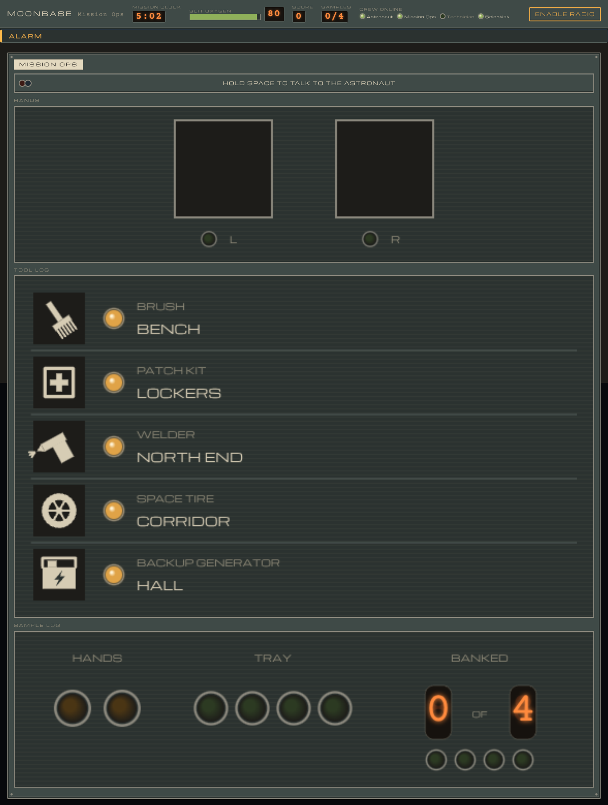
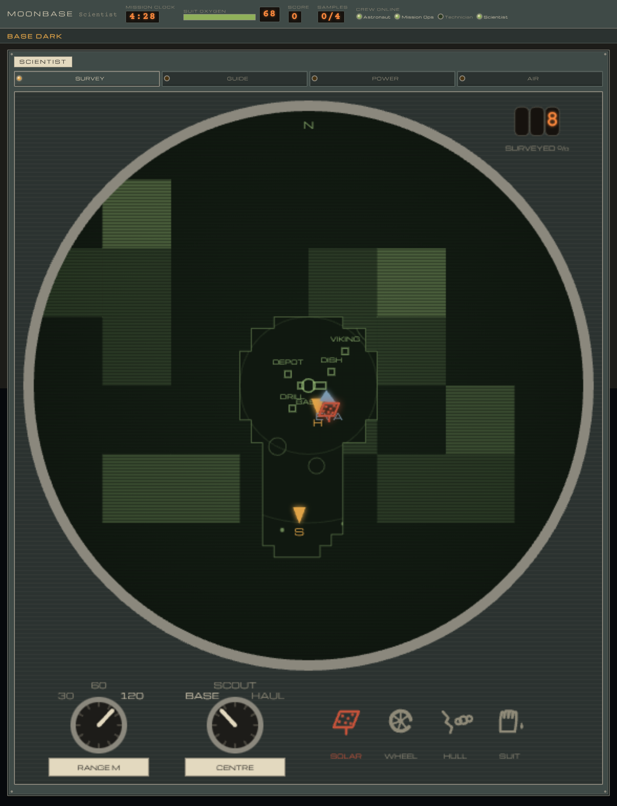
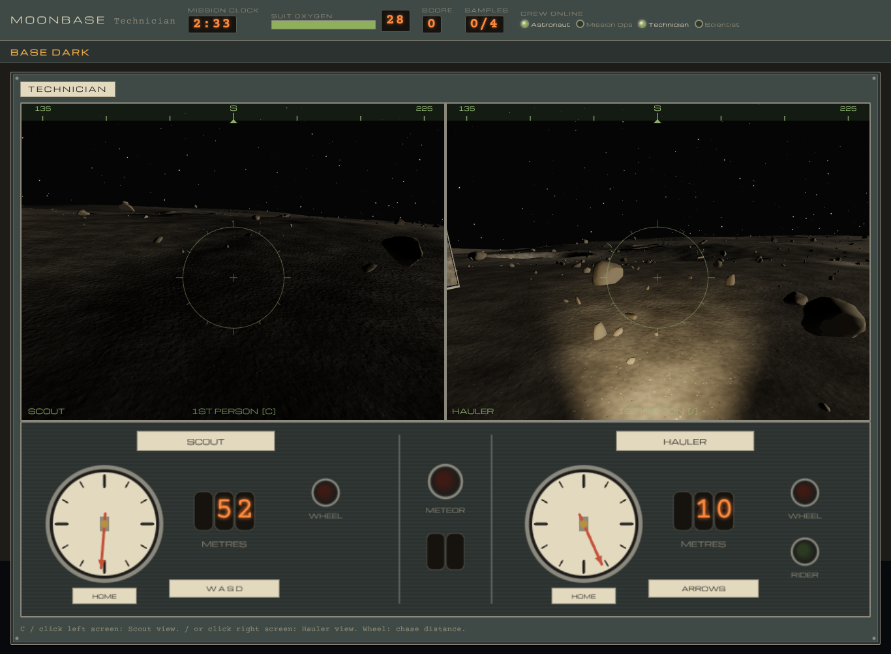
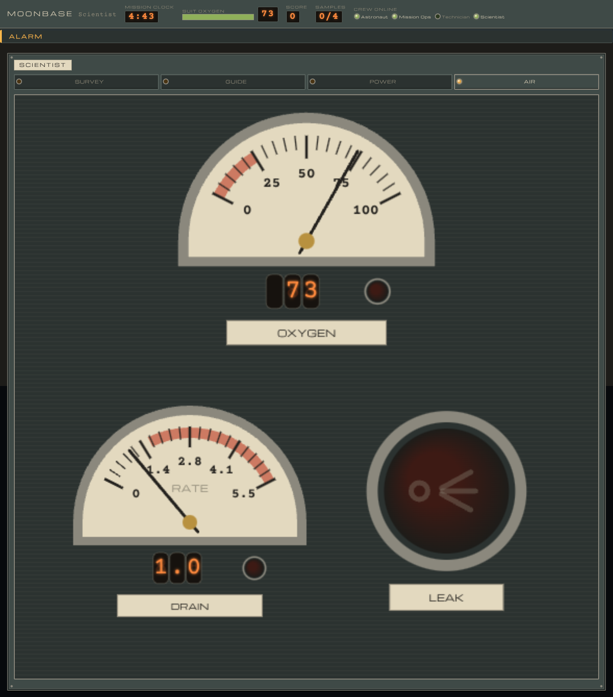
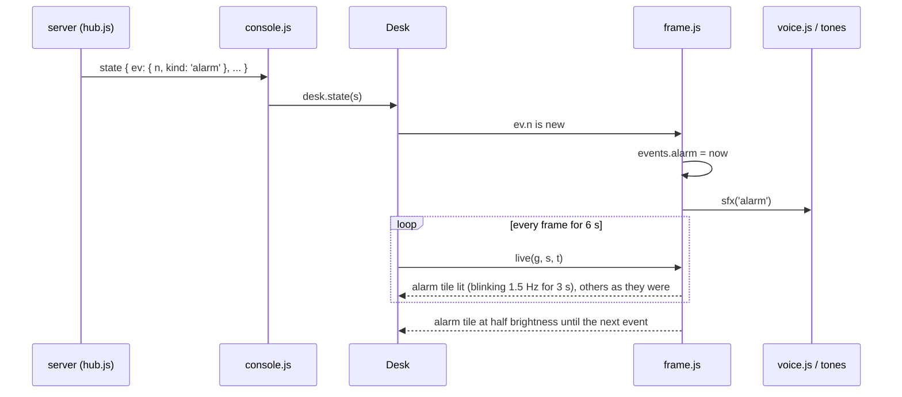
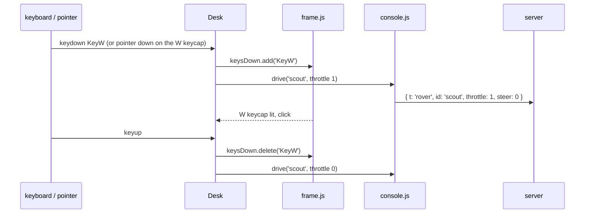
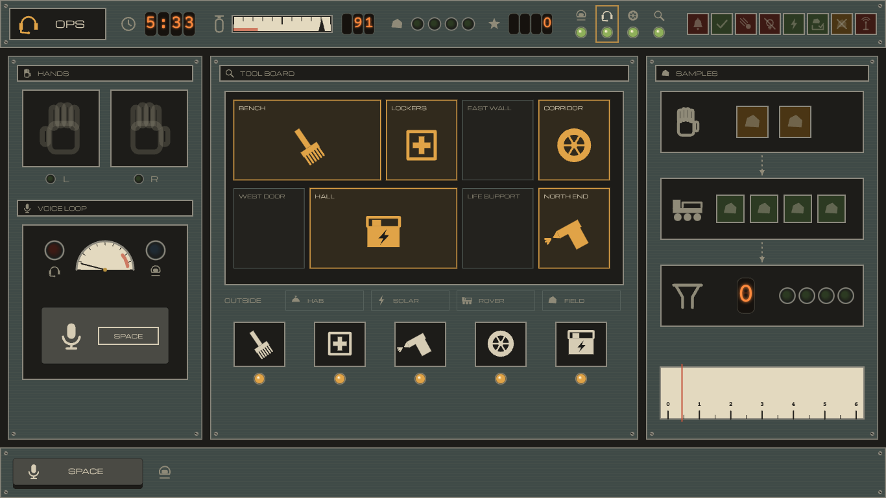
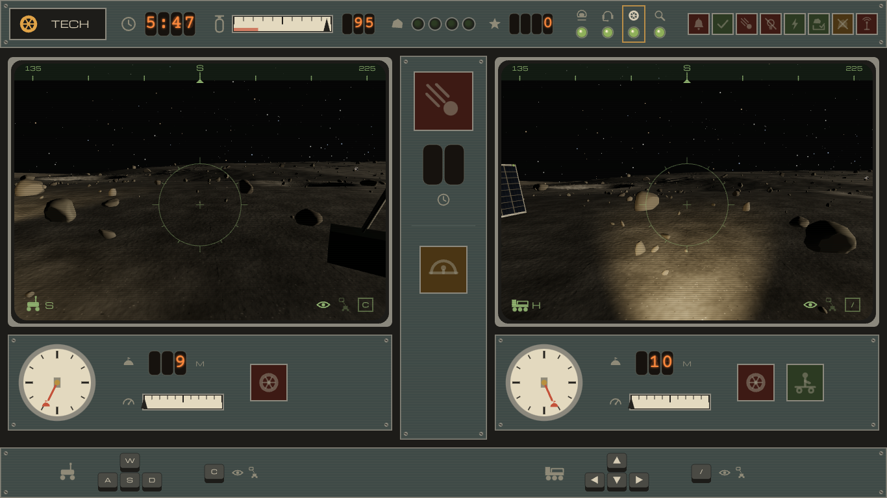
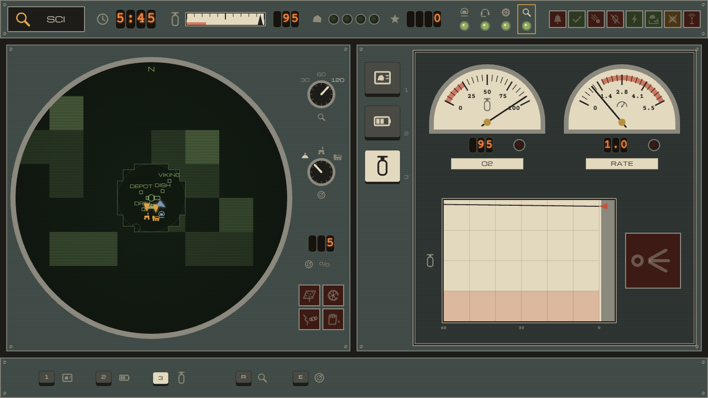
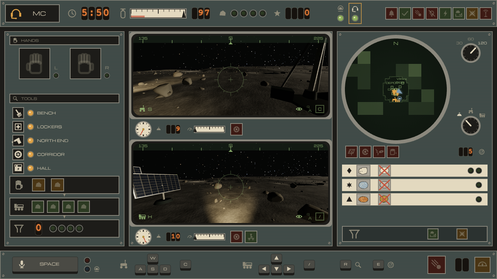

# Design: Mission Control consoles that look like a control room

Spec: [../specs/mission-control-consoles.md](../specs/mission-control-consoles.md). Process: [../WORKFLOW.md](../WORKFLOW.md). Look: [../DESIGN.md](../DESIGN.md).

Status: **built.** Reviewed and accepted with three changes (section 9: A1 to A3): a gap between the Scientist's scope and its switches, desks that fit every common laptop shape, and a simpler 2-player desk on one screen. The pictures in section 6 are the consoles as built; the mock-ups they were drawn from ([mission-control-consoles/mock.js](mission-control-consoles/mock.js)) are kept in section 6 for comparison.

## 0. Where we are, and what a real control room does

### The consoles today

Captured from a live demo mission at 1366 px wide, one seat per laptop. These are whole-page captures: everything below the first 768 px has to be scrolled to.

| Mission Ops | Scientist (SURVEY tab) |
| --- | --- |
|  |  |

| Technician | Scientist (AIR tab) |
| --- | --- |
|  |  |

The other two Scientist tabs: [GUIDE](mission-control-consoles/now-sci-guide.png), [POWER](mission-control-consoles/now-sci-power.png).

What is wrong with them, in order of how much it hurts:

1. **The page scrolls.** A single seat's panel is a column of canvases at `width:100%`. At 1366 px wide the Mission Ops page is 1808 px tall and the Scientist's is 1785: the hands fill the first screen, and the tool log, the sample log and the scope's knobs are below the fold.
2. **The pictures are blurred.** Each canvas has a fixed backing store (560 px wide for most) and is stretched by CSS to the panel's width, about 1300 px on a single-seat page. Every label and needle is drawn at 0.43 of the resolution it is shown at.
3. **Alarms are a line of text.** `#toast` prints `ALARM`, `FIXED`, `METEOR HIT`. It is the least instrument-like thing on the page and the thing a player most needs to catch out of the corner of an eye.
4. **Captions do the work pictures should.** MISSION CLOCK, SUIT OXYGEN, SCORE, SAMPLES, CREW ONLINE and four seat names in the header; HOLD SPACE TO TALK TO THE ASTRONAUT; a hint sentence under the cameras; `1ST PERSON [C]` on the camera glass.
5. **Instruments are far from what they describe.** The Technician's dials are on one strip under both cameras; the eye has to work out which half belongs to which rover.
6. **Everything is a snapshot.** There is no instrument that shows a trend, so "oxygen is falling faster than it was" has to be worked out from a number changing.

### What a Mission Operations Control Room desk has

The reference is the Apollo-era MOCR, which is also our period, with two ideas that every control room since has kept.

| In the room | What it does | Here |
| --- | --- | --- |
| **Event light panels**: a grid of square lamps with a legend on each, the same grid on several desks | Tells you *that* something happened, at the edge of your vision, without reading | The event lights (D3) |
| **A fixed console**: one desk, every instrument always in the same place, nothing scrolls or moves | Position becomes meaning: you look where the thing lives | One desk, one screen (D1) |
| **The intercom keyset**: a row of lit keys for the voice loops, lamps for who is talking | The hand rests on it; the lamp says the loop is live | The keyset and the talk key (D5, D8) |
| **Mission clocks** on every desk and the front wall, all the same | One time, shared | The status strip (D2) |
| **Strip-chart recorders and plot boards**: pens on moving paper | Shows the trend, not the value | The recorder (D11) and the mission tape (D9) |
| **Meters under the screen they belong to** | No hunting | The Technician's per-rover panels (D10) |
| **A plan or plot on the big screen** | Where things are, as a picture | The tool board (D7), the survey scope |

What we do **not** take: the walls of tabular numbers on a real flight controller's screen. SPEC-v2 says players read pictures, and that stands.

## 1. Reading of the spec

| | Requirement |
| --- | --- |
| R1 | Each seat's console fits 1366 x 768 with no scroll, and is sharp at any size up to 1920 x 1080 and at device pixel ratio 2. |
| R2 | Every desk has the same frame: status strip on top, event lights in it, keyset along the bottom. |
| R3 | The status strip shows the seat, the mission clock, suit oxygen, samples banked, the score and a lamp per seat, with pictures in place of captions. |
| R4 | Eight event lights, the same and in the same order on every desk, replace the toast line. A light comes on with its event and fades after a few seconds. |
| R5 | The keyset shows this seat's keys as keycaps with pictures. A keycap lights while its key is held. |
| R6 | Captions become pictures everywhere, except words a player says aloud and a meter's plate. No sentences on a mission screen. |
| R7 | Mission Ops: two hands as gloves with their contents; a tool board (plan of the hall by named bay, plus outside); the sample flow hands → tray → bank; a mission tape. |
| R8 | Mission Ops' talk key is an intercom key with a transmit lamp, a receive lamp and a level meter. |
| R9 | Technician: two monitor-like camera screens, each rover's instruments under its own screen, the meteor warning between them, a speed meter per rover, the view and its key as pictures on the glass. |
| R10 | Scientist: the survey scope always on screen; a second display switched between field guide, power and air. |
| R11 | Power and air each have a strip-chart recorder of the last 60 seconds. |
| R12 | Every action has a visual and a sound answer. |
| R13 | Every instrument has a name in words for hover and for screen readers. |
| R14 | No seat learns anything new; the server and the wire are unchanged. The lobby, the briefing sheet and the debrief are untouched. |

## 2. Decisions

| | Decision | Why | Overturn → |
| --- | --- | --- | --- |
| D1 | **A fixed design width of 1366 per console, scaled uniformly to the window**, drawn at `devicePixelRatio`. The height follows the screen between 768 (16:9) and 911 (3:2), so 16:9, 16:10 and 3:2 laptops are filled exactly (A2); only wider or taller windows are letterboxed on `bakelite`. Layout is in design pixels. | A console is a physical desk: it does not reflow. One coordinate system for layout, hit tests and tests. Fixes the scroll and the blur in one move. | A responsive CSS grid of separate canvases. More work, and instruments move about between laptops. |
| D2 | The status strip is **one canvas**, not DOM. The DOM header (`#clock`, `#o2`, `#score`, `#samples`, `#crew`) stays in the page, visually hidden, still updated, as the accessible text (R13) and so nothing that reads those ids breaks. | Nixie tubes, an edgewise meter and jewel lamps are canvas drawings already (`nixie`, `jewel` in `palette.js`). | Keep the DOM header and restyle it with CSS only. Cheaper; the oxygen meter and lamps stay flat. |
| D3 | **Eight event lights, fixed order:** alarm, fixed, meteor hit, base dark, power back, sample banked, dud, no link. A light is full-on for 6 s after its event, blinking at 1.5 Hz for the first 3 s if it is red, then off. The last event's light stays at half brightness until the next one. | The eight are exactly the `TOAST` kinds every seat already receives in `s.ev`, plus the link warning. Half-bright "last event" keeps what the toast line gave: you can look up late and still see what you missed. | Light only while the condition holds. That needs the server to say what is active, which tells seats things they do not know today (R14). |
| D4 | The generator-running event (`gen`) lights the **power back** lamp in amber instead of green. No ninth lamp. | Eight fit the strip at 30 px; the two are the same idea (the lights are on) with a caveat. | A ninth lamp. |
| D5 | The keyset is **drawn, and it is also the click target** for seats on a touchpad: pressing a keycap with the pointer does what the key does. | Mission Ops' talk button already works by pointer; this makes that general. | Draw only. |
| D6 | **Icons are canvas functions in `client/shared/icons.js`**, one `drawIcon(g, name, x, y, size, color)` in the house style of `drawTool` and `drawFault`: a 100-unit box, one colour, 8-unit round strokes. No icon font, no SVG sprite, no image files. | The same picture on the console and on any in-world screen; nothing to load; scales to any size; one colour means the lamp colour carries the status. | SVG files under `client/`. Easier to edit by hand, harder to tint and to draw onto a three.js canvas texture. |
| D7 | The tool board shows **the bay, not the spot.** A tool's silhouette is centred in the bay the server names in `tools[id].area`; two tools in a bay sit side by side. Bays keep their engraved names. | Mission Ops is sent each tool's exact `x, z` but today is shown only the area word, on purpose ("Ops knows roughly where; the astronaut has to look"). The names stay because Ops has to *say* "on the bench". | Plot the exact spot. Makes Ops' job trivial and the astronaut's search pointless. |
| D8 | The level meter on the talk key shows **the microphone's own level while transmitting and the received level while receiving**, from an `AnalyserNode` on each path in `voice.js`. | It is the instrument that tells Ops the microphone is actually working, which today they learn only when the astronaut does not answer. | A meter that just kicks to a fixed position. No audio work. |
| D9 | The mission tape is built **in the page**, from the `s.ev` events this seat has seen since the mission started. It is lost on a reload. | No server change (R14). Each seat's tape holds only what that seat was told. | Have the server send its `log` during the run. It carries text and fault types that Ops is not shown today. |
| D10 | The Technician's WASD and arrow keycaps are **on the keyset under the rover they drive**, and the hint paragraph is removed. The `C` and `/` view keys appear twice: on the keyset and on the glass. | The glass is where the eye is when the view changes. | Keyset only. |
| D11 | The recorder samples at **2 Hz into a 120-point ring buffer** (60 s), in the page. Paper moves left; the pen is at the right edge. The red band on the paper is the same limit as the dial's red arc. | Enough to see a leak's change of slope within about five seconds. Costs nothing between samples. | A longer window (the whole mission). Flatter slopes, harder to see a change. |
| D12 | The Scientist's scope is permanent; **GUIDE, POWER and AIR share the second display**, chosen by three lit push-buttons (keys 1, 2, 3). The push-buttons carry **no attention lamp**: nothing tells the Scientist that air needs looking at. | SPEC-v2 wants players to "go looking". This keeps the looking for the three pages that are diagnosis, and stops the chart (which the whole crew navigates by) from disappearing while the Scientist checks a gauge. | (a) Keep four tabs as now. (b) Add an amber lamp on a push-button whose page is out of limits: more realistic (a master caution), but it gives the diagnosis away. |
| D13 | The scope's RANGE and CENTRE knobs gain keys (**R** and **E**), shown on the keyset. Clicking a knob still works. | The Scientist's hands are otherwise idle; the keyset should not be empty. | Click only. |
| D14 | **The all-in-one seat (`/control`, 2-player mode) has its own, simpler desk on one screen** (A3, 6.7): hands, tools and samples on the left; the two cameras one over the other in the middle; the scope and a one-row-per-sample guide on the right. No switching between consoles. | One player runs the whole base, so everything must be in view at once, and there is less of it to read than the three 4-player desks put together. | Switch between the three full desks with F1 to F3 (the first version of this decision). |
| D15 | Seat names on the strip are the short forms **EVA, OPS, TECH, SCI**; the seat's own plate has its picture and its short name. | They are what the crew says on the loop. | Pictures only. |
| D16 | The score keeps a **star** as its picture. | It is the one header item with no physical object behind it. | A plate reading PTS. |

## 3. CRC cards

**`client/console.js` · the page** (shrinks: the drawing moves out)
- R: connect, hold `state`, run the lobby, the briefing sheet and the debrief exactly as now.
- R: `+` own one `<canvas id="desk">` and a `Desk` (below); pass it state and input.
- R: `+` keep the hidden DOM header updated (D2).
- R: `−` `#toast` text, `#ptt` button text, `.tabs`, `#camHint`, the per-panel canvases (`handsCv`, `toolCv`, `sampleCv`, `techCv`, `surveyCv`, `guideCv`, `powerCv`, `airCv`) and their `draw*` functions.
- C: `desk.js`, `net.js`, `voice.js`, `lobby.js`, `rovercam.js`.

**`client/console/desk.js` · `Desk`** `+`
- R: the 1366 x 768 design space: fit to the window, set the backing store to CSS size x `devicePixelRatio`, map pointer events back to design pixels.
- R: a list of **instruments**, each `{ id, name, x, y, w, h, static(g), live(g, s, t), hit?(x, y), key? }`. `static` is drawn once into an offscreen layer (faces, bezels, ticks, plates); `live` is drawn every frame (needles, lamps, digits, traces).
- R: the frame clock: 30 fps while anything is `swinging`, 10 fps otherwise, 0 when hidden (as `console.js` does now).
- R: hover and focus: sets `canvas.title` and an `aria-live` line to the instrument's `name` (R13).
- R: `shown`: a plain record of what each instrument last drew (`{ clock: '4:12', event: ['alarm'], hands: [null, 'brush'], ... }`) for tests, as `arm.shown` does for the wrist cuff.
- C: `frame.js`, `ops.js`, `tech.js`, `sci.js`, `instruments.js`.

**`client/console/instruments.js`** `+` (moved from `console.js`, plus new)
- R: `dial`, `homeDial`, `knob`, `plate`, `label`, `needle` (moved, unchanged in look).
- R: `+ face` (panel with bezel and screws), `+ well`, `+ tile` (event light), `+ keycap`, `+ edgewise`, `+ strip` (recorder), `+ crt` (monitor glass mask and raster).
- C: `palette.js`, `icons.js`.

**`client/console/frame.js` · status strip, event lights, keyset** `+`
- R: draws R3, R4, R5 for any seat. Holds the event lights' timers. Holds which keys are down.
- C: `desk.js`; reads `s.timeLeft`, `s.oxygen`, `s.o2Max`, `s.tally`, `s.score`, `s.crew`, `s.ev`, `net.open`.

**`client/console/ops.js`** `+` · **`tech.js`** `+` · **`sci.js`** `+`
- R: the three desks of section 6, as lists of instruments. `sci.js` takes `drawSurvey` and `drawGuide` whole; their content does not change.
- R (`ops.js`): the mission tape's event list (D9).
- R (`sci.js`): the two ring buffers (D11); which auxiliary page is up.
- R (`tech.js`): positions the two `rovercam.js` views under the CRT masks.

**`client/shared/icons.js`**
- R: `+ drawIcon(g, name, x, y, size, color)` with the set in section 6.5. `drawTool`, `drawFault`, `drawGlyph`, `drawSample` unchanged.

**`client/rovercam.js` · `startRoverCam`**
- R: `+` render each camera into a rectangle it is given (`setRects([{x, y, w, h}, ...])` in CSS pixels) instead of the two halves of its own canvas. Nothing else changes.

**`client/voice.js` · `Radio`**
- R: `+ level()`: 0 to 1, the microphone's level while talking, the received level otherwise (D8).

**`client/style.css`**
- R: `+` `#desk` fills the viewport under nothing; `body.period` has no scroll during a run. `−` the `.period` rules for `header`, `#toast`, `#ptt`, `.tabs`, `canvas.pic`, `.camwrap` once nothing uses them.

**`client/console.html`**
- R: `+ <canvas id="desk">`; the header gets `class="sr"` (visually hidden).

Not on a card, so unchanged: `server/*`, `client/shared/config.js`, `client/lobby.js`, the lobby SVGs and CSS, the briefing sheet, the debrief (`renderResults`), `client/astronaut.js` and everything in the headset.

## 4. State

**Server and wire: no change.** Every instrument reads fields the seat's `view()` already has:

| Instrument | Reads |
| --- | --- |
| Status strip | `timeLeft`, `oxygen`, `o2Max`, `tally.{banked,wanted}`, `score`, `crew` |
| Event lights | `ev.{n,kind}`; `net.open` |
| Hands | `hands[2]`, `carry[]` |
| Tool board | `tools[id].{at,area,inside}` (not `x`, `z`: D7) |
| Sample flow | `carry[]`, `tray[]`, `tally` |
| Technician panels | `rovers[id].{x,z,ry,v}`, `scene.wheels[id]`, `rider`, `meteor.{eta,falling}`, `tray` is **not** sent to the Technician: see the open question below |
| Scope, guide, power, air | `survey`, `manifest`, `assay`, `power`, `oxygen`, `drain`, `leak` |

New state, **in the page only**:

```js
frame.events   = { alarm: tLit, solve: tLit, ... }       // when each event light last lit (ms)
frame.keysDown = Set<code>
ops.tape       = [{ at: secondsIntoMission, kind }]      // from s.ev, reset when phase becomes 'run'
sci.trace      = { o2: Float32Array(120), batt: Float32Array(120), head, last }
sci.aux        = 'guide' | 'power' | 'air'               // also in localStorage 'moonbase.sci.aux'
desk.seat      = 'ops' | 'tech' | 'sci'                  // the all-in-one seat only (D14)
```

Event kind → light: `alarm`→alarm, `solve`→fixed, `hit`→meteor hit, `blackout`→base dark, `power`→power back (green), `gen`→power back (amber, D4), `found`→sample banked, `dud`→dud; `!net.open`→no link, held while it is true.

**Open question for the reviewer.** The mock-up puts a small tray lamp row on the Hauler's panel. The Technician's view has no `tray`. Either drop those lamps (default: **drop**, R14) or add `tray` to the Technician's view, which is a rule change and belongs in its own spec.

## 5. Sequences





The server stays authoritative for everything; the page only decides how to draw it.

## 6. UI layouts

All three are 1366 x 768 design pixels. Palette names are from DESIGN.md. Panels are `console` faces with a `bezel` edge and corner screws; recesses are `bakelite` wells; instrument faces are `dial`.

### 6.1 The frame (every seat)

```
0 ┌──────────────────────────────────────────────────────────────────────────────────────────┐
  │ [seat plate] (clock) 4:12  (bottle) ▕▔▔▔▲▔▏ 71  (rock) ●○○○  (star) 250  ⛑ 🎧 ⚙ 🔍  ▣▣▣▣▣▣▣▣ │ status strip, 74
74├──────────────────────────────────────────────────────────────────────────────────────────┤
  │                                                                                          │
  │                              the seat's own desk, 604 high                               │
  │                                                                                          │
690├──────────────────────────────────────────────────────────────────────────────────────────┤
  │ keyset: this seat's keys as keycaps, each with its picture                               │ 78
768└──────────────────────────────────────────────────────────────────────────────────────────┘
```

(The symbols in the sketch stand in for the canvas icons of 6.5; no emoji is drawn.)

- Seat plate: a `bakelite` well, the seat's icon in `lamp-amber`, its short name in `ink`.
- Clock, oxygen number, score: Nixie. Oxygen also on an edgewise meter with the bottom quarter painted `lamp-red`.
- Samples: one `lamp-green` jewel per sample wanted, lit as banked.
- Crew: four icons with a `lamp-green` jewel under each (on = seat connected); this seat's pair is boxed in `lamp-amber`.
- Event lights: 30 px tiles, `lamp-red` / `lamp-green` / `lamp-amber` by kind; off is the lamp's off colour with the icon in dim `ink-dim`, on is the on colour with the icon in `ink-dial`.

### 6.2 Mission Ops



The mock-up it was built from: [mock-ops.png](mission-control-consoles/mock-ops.png).

- **Left wing, HANDS and VOICE LOOP.** Two wells, each with a glove outline (left hand mirrored); the tool's silhouette or a rock is drawn over the palm in `ink`; a `lamp-green` jewel under it is lit while the hand is full. Below, the talk key: a wide keycap with the microphone and a SPACE outline, a `lamp-red` transmit lamp over the headset icon, a `lamp-blue` receive lamp over the helmet icon, a cream level meter between them.
- **Centre, TOOL BOARD.** A plan of the hall as eight bays (BENCH is double width, HALL is the open floor). A bay with a tool in it is outlined in `lamp-amber` with the silhouette in `lamp-amber`. Under it a row of four OUTSIDE bays (HAB, SOLAR, ROVER, FIELD: the server's `OUTSIDE …` areas; a named landmark shows in FIELD with its name on the bay). Under that the roster: five silhouettes with a jewel each, green in a hand, amber lying somewhere, dark used up or fitted.
- **Right wing, SAMPLES.** Top to bottom with dotted arrows: glove → two `lamp-amber` tiles (one per rock carried); Hauler → four `lamp-green` tiles (cups full); hopper → Nixie count, four `lamp-green` jewels over the four sample glyphs, and the dud lamp. At the foot, the mission tape: cream paper, minute numerals in Courier Prime, a `lamp-red` needle at now, an icon above the scale for each event.
- **Keyset:** the SPACE key. (Plus the three seat keys in the all-in-one seat.)

### 6.3 Technician



On a 16:10 screen (1440 x 900) the desk is 854 high and the extra goes to the monitors: [built-tech-16x10.png](mission-control-consoles/built-tech-16x10.png). The mock-up: [mock-tech.png](mission-control-consoles/mock-tech.png).

- **Two monitors**, 572 x 396, each a `bezel` frame, a `bakelite` inner lip and glass with 22 px corners; the live `rovercam.js` view shows through; a faint raster over it. On the glass in `phosphor`: the compass tape and the clock reticle as now; bottom left the rover's silhouette and its letter (S, H); bottom right the eye and the chase icons (the one in use bright) and the view key in a box.
- **Under each monitor**, that rover's panel: the HOME dial (the needle now carries a small base on its tip, so it needs no plate), the range on Nixie beside a base icon, a speed edgewise meter beside a speedometer icon, a WHEEL event tile (`lamp-red`, blinking, when its wheel is broken), and on the Hauler a RIDER tile (`lamp-green` while the astronaut is aboard).
- **The pillar** between them: a large METEOR tile, the seconds on Nixie over a clock icon; below a rule, a TAKE COVER tile (`lamp-amber`, lit with the warning). The two small lamps under it in the mock-up are dropped (they would need data the Technician is not sent).
- **Keyset:** W A S D under the Scout with its silhouette, the arrows under the Hauler with its, and C and / each beside the eye and chase icons.

### 6.4 Scientist



The scope's bezel now stops 15 px short of the switches' stops (A1); in the mock-ups ([AIR](mission-control-consoles/mock-sci-air.png), [POWER](mission-control-consoles/mock-sci-power.png)) the CENTRE switch's base icon overlapped the heat map. On a 3:2 screen (1500 x 1000): [built-sci-3x2.png](mission-control-consoles/built-sci-3x2.png).

- **Left, the scope:** `drawSurvey` unchanged in content, radius 276. The rovers and the astronaut wear their icons in place of the letters S, H and EVA; the base wears the base icon. To its right, top to bottom: RANGE knob (numerals stay), CENTRE knob with base, Scout and Hauler icons at its stops, the surveyed percentage on Nixie, and the four fault symbols as a 2 x 2 block of event tiles (the legend, without its captions).
- **Right, the auxiliary display:** three push-buttons down the left edge (card, battery, bottle; the one in use is lit `dial`), numbered 1 to 3. The display itself is a `console-deep` face in a well.
  - **AIR:** O2 dial and RATE dial as now, the recorder under them with a bottle icon and the bottom quarter of the paper tinted red, the LEAK tile beside it.
  - **POWER:** BATT dial and SUN dial, the recorder with a battery icon, and CHARGE / DRAIN as two tiles: a battery with an arrow in, `lamp-green`; a battery with an arrow out, `lamp-amber`.
  - **GUIDE:** `drawGuide` as it is: the cream cards already are pictures. Its SIZE / WHERE / TELL / NOT THIS captions stay: they are the plates of four pictures and the Scientist says them aloud.
- **Keyset:** 1 2 3 with the page icons, R with the magnifier (range), E with the scope (centre).

### 6.5 The icon set

One function, `drawIcon`, one colour per call. New names: `clock`, `o2`, `rock`, `score`, `helmet`, `headset`, `wheel`, `lens`, `link`, `mic`, `bell`, `fixed`, `meteor`, `bolt`, `dark`, `banked`, `dud`, `glove`, `home`, `rider`, `eye`, `chase`, `scout`, `hauler`, `cover`, `tray`, `port`, `scope`, `card`, `battery`, `speed`. All are drawn in the mock-ups; `mock.js` has a first cut of each to lift.

Rules for anyone adding one: a 100-unit box centred on the origin; filled shapes or 8-unit round strokes, nothing thinner than 5; readable at 16 px (check it there, not at 60); it must not be the tool that fixes the thing (the rule `drawFault` already keeps); and it gets a row in the legend below.

### 6.6 The words that remain

| Where | Words | Why they stay |
| --- | --- | --- |
| Seat plate, crew row | EVA, OPS, TECH, SCI | Said on the loop |
| Tool board | BENCH, LOCKERS, EAST WALL, CORRIDOR, WEST DOOR, HALL, LIFE SUPPORT, NORTH END; HAB, SOLAR, ROVER, FIELD and landmark names | Ops says them to the astronaut |
| Camera tape, scope | N E S W, bearings | Said on the loop |
| Meter plates | O2, RATE, BATT, SUN | A meter's engraved plate |
| Panel titles | HANDS, VOICE LOOP, TOOL BOARD, SAMPLES | One plate per panel, with its icon |
| Keycaps | W A S D, C, /, 1 2 3, R, E, SPACE | They are the keys |
| Units | M, % | |
| Field guide | SIZE, WHERE, TELL, NOT THIS | Plates of pictures |

Everything else on a mission screen today is removed or becomes a picture: 5 header captions, 4 seat names, the toast words, the talk-key sentence, HANDS / TRAY / BANKED / OF, tool names and LEFT HAND / RIGHT HAND / USED / FITTED, SCOUT / HAULER, HOME, METRES, WHEEL, RIDER, METEOR, W A S D and ARROWS plates, the camera hint sentence, `1ST PERSON [C]`, SURVEY / GUIDE / POWER / AIR, RANGE M, CENTRE, SURVEYED %, the four legend names, LOW, CHARGE, DRAIN, LEAK, PERCENT.

### 6.7 The 2-player desk (`/control`)



One player runs the whole base, so this desk is the three 4-player desks cut down to what one person can watch at once, all on one screen (D14, A3):

- **Left:** HANDS (two gloves, a lamp each); TOOLS, one row per tool: its silhouette, its lamp (green in a hand, amber lying, dark used up) and the bay it lies in as a word, or L or R in a hand; and the samples on their way home (hands, tray, bank) as three compact rows.
- **Middle:** the two rover cameras, one over the other, each with a strip of instruments under it: the HOME dial, the range, speed, the WHEEL lamp and, on the Hauler, the RIDER lamp.
- **Right:** the survey scope (radius 140) with RANGE and CENTRE beside it, the four fault lamps and the surveyed percentage under it, then the field guide as one row per kind of sample (its glyph, its picture, its lookalike struck through, a lamp per piece wanted) and the ASSAY strip.
- **Keyset:** SPACE with the transmit and receive lamps, W A S D and C for the Scout, the arrows and / for the Hauler, R and E for the scope, and the meteor warning (lamp, seconds, TAKE COVER) at the right end.

Left out against the 4-player desks: the tool board's plan of the hall, the mission tape, the voice-loop panel, the POWER and AIR pages (the scope's blinking fault symbol and the fault lamps say which fault it is; the status strip has the oxygen) and the guide's SIZE, WHERE and TELL pictograms. On a 3:2 screen the guide rows grow: [built-2p-3x2.png](mission-control-consoles/built-2p-3x2.png).

### 6.8 Laptop screens

| Screen | Examples | Desk (design px) |
| --- | --- | --- |
| 16:9 | 1366 x 768, 1920 x 1080, 2560 x 1440 | 1366 x 768 |
| 16:10 | 1280 x 800, 1440 x 900, 1680 x 1050, 2560 x 1600 (MacBook) | 1366 x 854 |
| 3:2 | 1500 x 1000, 2256 x 1504 (Surface, Framework) | 1366 x 911 |
| wider than 16:9 or taller than 3:2 | ultrawide, a window dragged narrow | letterboxed on `bakelite` |

Every desk is checked with no scroll at 1366 x 768, 1440 x 900, 1500 x 1000 and 1920 x 1080.

## 7. Implementation considerations

**Order of work.** Five steps, each one mergeable and each leaving all three seats playable:

1. `desk.js`, `instruments.js` (move the helpers, no visual change) and `drawIcon`. The old panels are still on the page.
2. `frame.js`: the status strip, event lights and keyset replace the header and the toast on all seats.
3. `ops.js`.
4. `tech.js`, with the `rovercam.js` rectangles.
5. `sci.js`, then the all-in-one seat (D14), then delete the dead CSS and refresh the pictures in `docs/`.

**Sharpness and scale.** `scale = min(innerWidth / 1366, innerHeight / 768)`; canvas CSS size is the design size x scale; backing store is that x `devicePixelRatio`, capped at 2732 x 1536 (a 4K laptop does not need more and four consoles may share one machine). Draw with `g.setTransform(k, 0, 0, k, 0, 0)` once per frame. Below 1180 x 660 text on plates falls under 8 px: show the console anyway, do not reflow.

**Two layers.** The static layer (faces, bezels, screws, dial faces and ticks, plates, well outlines, unlit tiles) is drawn once per resize into an `OffscreenCanvas` and blitted; the live layer draws only needles, lamps, digits, traces, the scope's contents and the camera overlays. Today every frame redraws every bezel and the brushed-metal lines (about 150 strokes a panel). Expect the idle frame to cost well under what it does now even though there is more on screen.

**The scope is the expensive instrument** (48 x 48 cells, three passes). Keep its own offscreen canvas and redraw it only when `survey.seen`, the range or the centre changes, or a wipe or bloom is running; otherwise blit it and draw the moving marks on top.

**The cameras.** `rovercam.js` renders both views into one WebGL canvas split down the middle. With the pillar between the monitors the two views are no longer adjacent halves: position the WebGL canvas behind the desk canvas (which has transparent holes where the glass is), and give `rovercam.js` the two rectangles to use as viewport and scissor. The rounded glass corners and the raster come free from the desk canvas on top. The existing `camHud` drawing moves into `tech.js` unchanged. Software-GL test machines draw this page at a frame or two a second: the capture for this document took minutes; budget for that in `smoke`.

**Recorder buffers** are sampled on a timer, not per frame, so a throttled background tab does not distort the time axis: on each sample, fill forward from `last` to now at 2 Hz with the current value.

**Input.** One `keydown` / `keyup` pair and one `pointerdown` / `pointerup` pair on the desk; each instrument with a `key` or a `hit` gets the event. Keep the existing guards (`e.repeat`, modifier keys, focus in an input). SPACE must not scroll or click a focused button. In the all-in-one seat, 1 2 3, R and E act only while the Scientist's desk is up; drive keys and SPACE always act.

**Accessibility and learning the pictures.** Removing captions removes the only help a new player has, so:
- every instrument has a `name` ("Suit oxygen, 71 percent"); hover sets the canvas `title`, and a visually hidden `aria-live="polite"` line carries event lights as they come on;
- the hidden DOM header keeps the numbers as text;
- status never rides on colour alone: each event light has its own picture and its own place, and red lamps blink where amber and green do not;
- the briefing sheet (opened from the lobby, before the mission) gets a **legend**: each icon this seat uses beside its word, drawn with `drawIcon` at 24 px. This is new content inside the existing sheet, not a restyle of the lobby.

**Colour.** No new hex values. Everything in the mock-ups is `PAL.*`, the lamp on/off pairs, or the two literals already in `console.js` (the scope's centre glass `#152015` and the Nixie envelope). The keycap body in `mock.js` uses `#4a4a44`: when lifting it, add it to `palette.js` as `keycap` and to DESIGN.md's surfaces table, or use `console`.

**Fonts.** Michroma for plates and keycaps, Courier Prime for dial numerals and the tape. Draw nothing until `fontsReady` resolves (already the rule), and redraw the static layer when it does.

**Tests that read the page.** `smoke.mjs` reads `#ptt`'s text for the radio check and clicks `[data-ready]`, `[data-ready-for]`, `[data-tab]`-free paths in the lobby; `camviews.mjs` and `avatar.mjs` read `#cam`. Keep `#cam` as the WebGL canvas's id. Replace the `#ptt` text check with `window.moonbase.desk.shown.talk` (`'idle' | 'tx' | 'rx'`).

**Risks.**
- *The pictures are not understood.* Mitigation: the legend, the hover names, and the one-minute test in the spec's "Done when" run with someone who has not seen the game.
- *One big canvas is harder to change than DOM.* Mitigation: the instrument list. A new lamp is one entry with a rectangle, not a layout change.
- *The all-in-one seat loses the at-a-glance view of all three.* It is the price of not scrolling; D14's overturn is the fallback for wide screens.
- *Mission Ops' tool board hides nothing but looks like a map.* A reviewer may read it as giving exact positions. It does not (D7); the bay outline, not a dot, is the cue.

## 8. Tests

| | Covered by |
| --- | --- |
| R1 | `smoke`: at 1366 x 768 and 1920 x 1080, `document.scrollingElement.scrollHeight <= innerHeight` on `/ops`, `/tech`, `/sci` during the run; `desk.canvas.width === round(clientWidth * devicePixelRatio)`. |
| R2, R3 | `smoke`: `desk.shown.clock`, `.oxygen`, `.banked`, `.score`, `.crew` equal the state on each seat. |
| R4 | `smoke`: after the dust alarm `desk.shown.event` includes `alarm` on all three seats; 7 s later it is half-bright (`desk.shown.last === 'alarm'`); `#toast` is gone. |
| R5, R12 | `smoke`: hold `KeyW` on `/tech`: `desk.shown.keys` includes it and the Scout's throttle is 1; release: neither. |
| R6 | `smoke`: count `fillText` calls on the desk canvas during a run (the trick `watchGaugeText` uses for the cuff) and check every string against the allow-list of 6.6. |
| R7 | `smoke`: `desk.shown.hands`, `.bays` (`{ BENCH: ['patch'], ... }`), `.flow` (`{ carry, tray, banked }`) and `.tape` follow the demo mission's take, drop, bank and alarm steps. |
| R8 | The radio check: `desk.shown.talk` is `tx` while SPACE is held and `rx` while the astronaut transmits; `radio.level() > 0` with the fake microphone. |
| R9 | `camviews`: as now, plus each view's rectangle lies inside its monitor's glass; `desk.shown.view` flips with C and /. |
| R10, R11 | `smoke`: keys 1 2 3 change `desk.shown.aux`; the scope's `shown.scope` is present on all three; after 10 s of leak the last ten points of `sci.trace.o2` fall faster than the ten before. |
| R13 | `smoke`: hovering the oxygen meter sets a `title` that contains the number. |
| R14 | `npm test` unchanged and passing; `git diff --stat server/ worker/` is empty. |
| Look | `npm run smoke:shots`: `mission-control-ops.png`, `-tech.png`, `-sci.png`. Check against DESIGN.md and the mock-ups here; replace `docs/mission-control.png` (which still shows the pre-1960s console) with the three. |

## 9. Amendments made while coding

- **A1** (sci.js): the scope's radius is at most 262 (the mock-up had 276) and the switches sit at x 620, so there is a 15 px gap between the scope's bezel and the nearest switch stop. In the mock-up the CENTRE switch's base icon overlapped the heat map.
- **A2** (desk.js, D1): the desk's height follows the screen: `H = clamp(1366 x innerHeight / innerWidth, 768, 911)`. 16:9 (1366 x 768, 1920 x 1080) gives 768, 16:10 (1440 x 900, 1280 x 800, 2560 x 1600) 854, 3:2 (1500 x 1000, Surface and Framework laptops) 911. Every layout takes its height from `regionOf(H)` and puts the extra into the tool board, the cameras, the recorders and the guide rows.
- **A3** (all.js, D14, 6.7): the 2-player seat gets its own desk rather than the three 4-player desks behind a switch.
- **A4** (desk.js): no separate `frame.js`: the status strip and the event lights are in `desk.js`, and each seat draws its own keyset. The scope is redrawn every frame (as it was before) rather than cached; the idle frame rate is still 10.
- **A5** (sci.js, D12): the Scientist's aux page is remembered in `localStorage` (`moonbase.sci.aux`), AIR by default.
- **A6** (tech.js): the Hauler's tray lamps from the mock-up are dropped (the Technician is not sent the tray: section 4's open question), and so are the two small lamps under TAKE COVER.

## 10. Out of scope

- The lobby, the briefing sheet's styling, the debrief screen ([SPEC-end-of-mission.md](../SPEC-end-of-mission.md)), the admin console.
- Anything in the headset.
- New information for any seat (an active-fault list, the tray for the Technician, exact tool positions for Ops).
- A front-wall "big board" view for spectators. It would suit this look; it is its own feature.
- Sound design beyond keeping today's sounds attached to the same events.

## Appendix: regenerating the pictures

- **Proposed:** serve the repo root with any static file server and open `/docs/design/mission-control-consoles/mock.html?seat=ops` (or `tech`, or `sci&aux=air`, `sci&aux=power`) at 1366 x 768. The stills here were taken with Playwright at device scale factor 2 and reduced to 1600 px wide.
- **Today:** four seats joined to a 4-player demo mission on a local server (`npm start`), screenshots taken with Playwright a few seconds after the first alarm.
